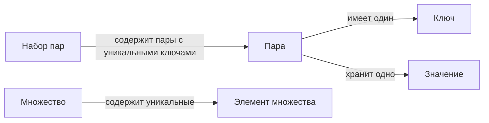
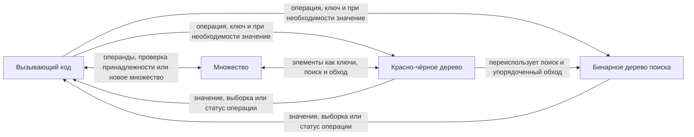

# Дизайн ЛР‑1. Деревья поиска

## 1. Постановка задачи

Реализовать две собственные нелинейные структуры данных для хранения пар «ключ — значение» — бинарное дерево поиска и красно-чёрное дерево. Обе структуры должны поддерживать добавление и удаление пар, поиск по ключу и изменение связанного значения.

Такие структуры применяются, когда нужно находить данные по идентификатору, получать пары в порядке ключей или выбирать пары между заданными границами. Красно-чёрное дерево ограничивает высоту, чтобы время поиска, вставки и удаления оставалось логарифмическим при любом порядке добавления ключей.

На основе красно-чёрного дерева реализовать множество для хранения уникальных элементов, проверки их принадлежности и построения новых множеств из двух исходных.

## 2. Сущности и связи

- **Набор пар** — данные, хранимые одним деревом. Ключи внутри набора уникальны.
- **Пара** — единица хранения, которая объединяет один ключ и одно значение.
- **Ключ** — упорядоченный идентификатор пары. По нему можно найти связанное значение.
- **Значение** — данные, связанные с ключом. У разных ключей могут быть одинаковые значения.
- **Множество** — совокупность уникальных элементов.
- **Элемент множества** — значение, по которому проверяют принадлежность множеству.

## 3. Архитектура

### Деревья поиска

У каждого узла есть ключ, значение и до двух потомков. Все ключи левого поддерева меньше ключа узла, все ключи правого больше. Поиск сравнивает искомый ключ с ключом текущего узла и выбирает одну ветвь. Вставка занимает найденную свободную позицию. При удалении лист отсоединяется, узел с одним потомком заменяется этим потомком. Если потомков два, позицию удаляемого узла занимает узел с наименьшим ключом в правом поддереве.

Симметричный обход посещает узлы по возрастанию ключей. При выборке диапазона пропускаются ключи меньше нижней границы, а обход прекращается при первом ключе больше верхней границы или при исчерпании дерева. Минимум и максимум определяются движением по крайней левой и крайней правой ветви соответственно.

При поиске поддерева ключ его корня определяет единственного кандидата. Дальше стек хранит пары соответствующих узлов для сравнения ключей, значений и ветвей.

Для извлечения поддерева поиск определяет его корень, а глубокое копирование переносит в новое дерево всю ветвь, начиная с найденного узла. Форма ветви сохраняется.

| Решение | Назначение и сложность |
|---|---|
| Обычное бинарное дерево поиска | Форма зависит от порядка вставки. Поиск, вставка и удаление занимают `O(h)`, где `h` характеризует высоту дерева. При вставке отсортированных ключей дерево вырождается в цепочку и операции занимают до `O(n)`. |
| Красно-чёрное дерево | Сохраняет порядок поиска и ограничивает высоту. Вставка и удаление восстанавливают баланс поворотами и перекрашиванием. Операции по ключу занимают `O(log(n + 1))`, где `n` — количество пар. |

В красно-чёрном дереве корень и отсутствующие потомки считаются чёрными. У красного узла потомки чёрные, а на всех путях от любого узла до отсутствующих потомков одинаковое число чёрных узлов. После вставки исправляется возможное соседство красных узлов. После удаления исправляется возможный дефицит чёрных узлов на затронутых путях. Повороты меняют форму дерева и сохраняют порядок ключей.

### Множество

Множество хранит элементы как уникальные ключи красно-чёрного дерева. Вставка, проверка принадлежности и удаление используют операции дерева и занимают `O(log(n + 1))` при `n` элементах.

Объединение копирует левое множество и добавляет элементы правого. Для пересечения и вычитания выполняется обход левого множества с проверкой принадлежности правому. Совпадения попадают в пересечение, остальные элементы обхода — в разность.

Обход начинается с наименьшего ключа. На каждом шаге следующий узел находится по связям с потомками и родителем.

Для проверки включения достаточно найти каждый элемент левого множества в правом. Если в левом множестве больше элементов, оно не может быть подмножеством правого. Для равенства нужны одинаковое число элементов и включение в одном направлении.

Преобразование, свёртка и фильтрация используют тот же обход по возрастанию ключей. Преобразование и фильтрация строят новые множества. Свёртка хранит один промежуточный результат и обновляет его на каждом ключе.

Для сохранения ключи обходятся по возрастанию. Каждый ключ записывается вместе с длиной своего текстового представления, чтобы при чтении можно было выделить его целиком. Прочитанные ключи вставляются в новое множество.

## 4. Функциональные требования

| Действие или условие | Ожидаемый результат |
|---|---|
| Создать пустое дерево | Размер равен нулю. Проверка наличия любого ключа даёт отрицательный результат. |
| Вставить пару | Пара с новым ключом появляется в дереве, размер увеличивается на один. При повторной вставке размер и прежнее значение сохраняются. |
| Проверить наличие ключа или запросить значение | Проверка сообщает о наличии ключа. Запрос значения возвращает связанное значение либо сообщает об отсутствии ключа, в том числе в пустом дереве. |
| Найти вхождение поддерева | Результат истинен, если в исходном дереве есть ветвь с такими же ключами, значениями и формой. Пустое поддерево считается входящим в любое дерево. |
| Извлечь поддерево по ключу корня | Возвращается независимая копия найденной ветви. Если ключ отсутствует, операция сообщает об ошибке. |
| Заменить значение | Значение существующей пары меняется при сохранении ключа и размера дерева. Если ключ отсутствует или дерево пусто, операция сообщает об ошибке. |
| Удалить пару | Ключ становится недоступен, размер уменьшается на один. Остальные пары сохраняются. Если ключ отсутствует или дерево пусто, операция сообщает об ошибке. |
| Получить ключи, пары или вывести ключи | Ключи следуют по возрастанию. Для пустого дерева выборка пуста и вывод отсутствует. |
| Выбрать пары из диапазона | Возвращаются пары в порядке возрастания ключей, включая обе границы при их наличии. Если совпадений нет, результат пуст. Нижняя граница больше верхней вызывает ошибку. |
| Получить значение корня или значение при крайнем ключе | Возвращается значение соответствующей пары. Запрос к пустому дереву вызывает ошибку. |
| Скопировать или переместить дерево | Копия сохраняет пары, форму и, для красно-чёрного дерева, цвета. Последующие изменения копии независимы от исходного дерева. При перемещении получатель получает содержимое, исходное дерево становится пустым. |
| Вставить или удалить ключ в красно-чёрном дереве | После операции сохраняются порядок ключей и красно-чёрные свойства. Для существующего ключа можно проверить цвет узла. Запрос цвета отсутствующего ключа вызывает ошибку. |

| Операция множества | Ожидаемый результат |
|---|---|
| Создать множество | Можно создать пустое множество или множество с одним заданным элементом. |
| Вставить элемент | Элемент принадлежит множеству. Повторная вставка сохраняет состав множества. |
| Проверить принадлежность | Возвращается результат проверки наличия элемента. |
| Удалить элемент | Элемент перестаёт принадлежать множеству. Для отсутствующего элемента операция сообщает об ошибке даже в пустом множестве. |
| Объединить два множества | Возвращается новое множество, содержащее каждый элемент, который входит хотя бы в один операнд. Операнды сохраняют свой состав. |
| Пересечь два множества | Возвращается новое множество с элементами, общими для обоих операндов. Операнды сохраняют свой состав. |
| Вычесть правое множество из левого | Возвращается новое множество с элементами левого операнда, отсутствующими в правом. Операнды сохраняют свой состав. |
| Проверить включение | Результат истинен, если каждый элемент левого множества входит в правое. Равные множества включены друг в друга, а пустое множество входит в любое. |
| Сравнить множества на равенство | Результат истинен, если множества состоят из одних и тех же элементов при любом порядке вставки. |
| Преобразовать элементы | Возвращается новое множество результатов преобразования. Одинаковые результаты образуют один элемент. |
| Свернуть множество | Начиная с начального значения, на каждом шаге функция получает текущий элемент и промежуточный результат. Для пустого множества возвращается начальное значение. |
| Отфильтровать элементы | Возвращается новое множество из элементов, удовлетворяющих условию. |
| Сохранить множество в строку | Возвращается текстовое представление всех элементов в порядке возрастания ключей. Пустому множеству соответствует пустая строка. |
| Прочитать множество из строки | Возвращается новое множество из записанных ключей. Повреждённая запись вызывает ошибку. |
