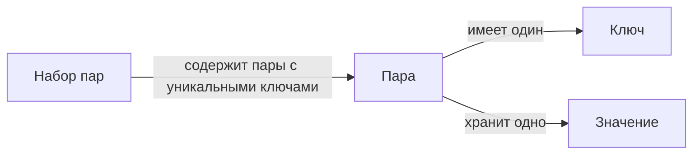
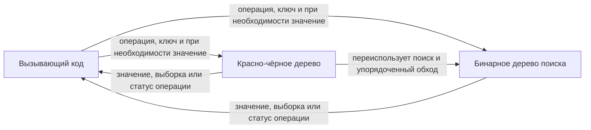

# Дизайн ЛР‑1. Деревья поиска

## 1. Постановка задачи

Реализовать две собственные нелинейные структуры данных для хранения пар «ключ — значение» — бинарное дерево поиска и красно-чёрное дерево. Обе структуры должны поддерживать добавление и удаление пар, поиск по ключу и изменение связанного значения.

Такие структуры применяются, когда нужно находить данные по идентификатору, получать пары в порядке ключей или выбирать пары между заданными границами. Красно-чёрное дерево ограничивает высоту, чтобы время поиска, вставки и удаления оставалось логарифмическим при любом порядке добавления ключей.

## 2. Сущности и связи

- **Набор пар** — данные, хранимые одним деревом. Ключи внутри набора уникальны.
- **Пара** — единица хранения, которая объединяет один ключ и одно значение.
- **Ключ** — упорядоченный идентификатор пары. По нему можно найти связанное значение.
- **Значение** — данные, связанные с ключом. У разных ключей могут быть одинаковые значения.

## 3. Архитектура

### Деревья поиска

У каждого узла есть ключ, значение и до двух потомков. Все ключи левого поддерева меньше ключа узла, все ключи правого больше. Поиск сравнивает искомый ключ с ключом текущего узла и выбирает одну ветвь. Вставка занимает найденную свободную позицию. При удалении лист отсоединяется, узел с одним потомком заменяется этим потомком. Если потомков два, позицию удаляемого узла занимает узел с наименьшим ключом в правом поддереве.

Симметричный обход посещает узлы по возрастанию ключей. При выборке диапазона пропускаются ключи меньше нижней границы, а обход прекращается при первом ключе больше верхней границы или при исчерпании дерева. Минимум и максимум определяются движением по крайней левой и крайней правой ветви соответственно.

| Решение | Назначение и сложность |
|---|---|
| Обычное бинарное дерево поиска | Форма зависит от порядка вставки. Поиск, вставка и удаление занимают `O(h)`, где `h` характеризует высоту дерева. При вставке отсортированных ключей дерево вырождается в цепочку и операции занимают до `O(n)`. |
| Красно-чёрное дерево | Сохраняет порядок поиска и ограничивает высоту. Вставка и удаление восстанавливают баланс поворотами и перекрашиванием. Операции по ключу занимают `O(log(n + 1))`, где `n` — количество пар. |

В красно-чёрном дереве корень и отсутствующие потомки считаются чёрными. У красного узла потомки чёрные, а на всех путях от любого узла до отсутствующих потомков одинаковое число чёрных узлов. После вставки исправляется возможное соседство красных узлов. После удаления исправляется возможный дефицит чёрных узлов на затронутых путях. Повороты меняют форму дерева и сохраняют порядок ключей.

## 4. Функциональные требования

| Действие или условие | Ожидаемый результат |
|---|---|
| Создать пустое дерево | Размер равен нулю. Проверка наличия любого ключа даёт отрицательный результат. |
| Вставить пару | Пара с новым ключом появляется в дереве, размер увеличивается на один. При повторной вставке размер и прежнее значение сохраняются. |
| Проверить наличие ключа или запросить значение | Проверка сообщает о наличии ключа. Запрос значения возвращает связанное значение либо сообщает об отсутствии ключа, в том числе в пустом дереве. |
| Заменить значение | Значение существующей пары меняется при сохранении ключа и размера дерева. Если ключ отсутствует или дерево пусто, операция сообщает об ошибке. |
| Удалить пару | Ключ становится недоступен, размер уменьшается на один. Остальные пары сохраняются. Если ключ отсутствует или дерево пусто, операция сообщает об ошибке. |
| Получить ключи, пары или вывести ключи | Ключи следуют по возрастанию. Для пустого дерева выборка пуста и вывод отсутствует. |
| Выбрать пары из диапазона | Возвращаются пары в порядке возрастания ключей, включая обе границы при их наличии. Если совпадений нет, результат пуст. Нижняя граница больше верхней вызывает ошибку. |
| Получить значение корня или значение при крайнем ключе | Возвращается значение соответствующей пары. Запрос к пустому дереву вызывает ошибку. |
| Скопировать или переместить дерево | Копия сохраняет пары, форму и, для красно-чёрного дерева, цвета. Последующие изменения копии независимы от исходного дерева. При перемещении получатель получает содержимое, исходное дерево становится пустым. |
| Вставить или удалить ключ в красно-чёрном дереве | После операции сохраняются порядок ключей и красно-чёрные свойства. Для существующего ключа можно проверить цвет узла. Запрос цвета отсутствующего ключа вызывает ошибку. |