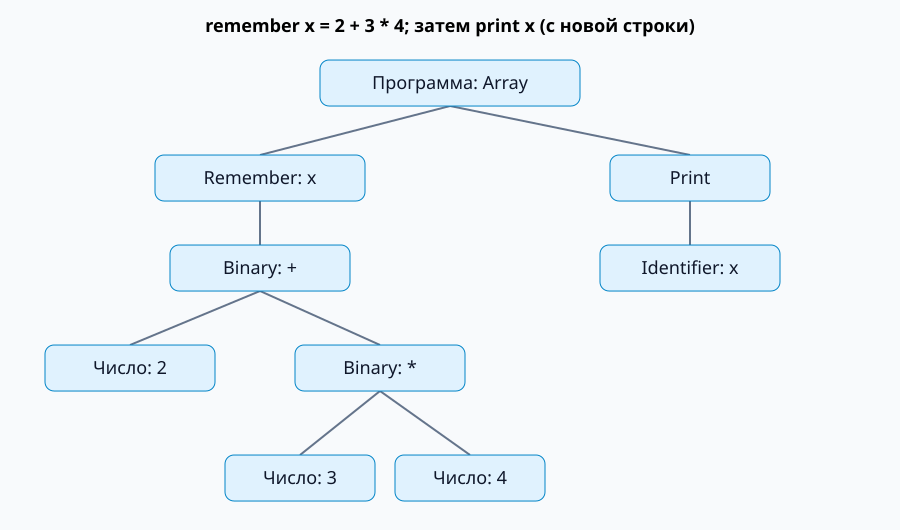

# Архитектура MiniLang

Общий путь программы проходит через `Lexer → Parser → AST → Interpreter`. Точка входа CLI читает файл и связывает компоненты. Библиотека `MiniLangCore` содержит лексер, парсер, AST, дерево выражений и исполнитель, её используют CLI и `InterpreterTests`. Синтаксис и семантика описаны в [спецификации](specification.md).

| Компонент | Вход | Результат |
|---|---|---|
| `Lexer::tokenize` | Исходный текст | `Array<Token>` с завершающим EOF |
| `Parser::parse` | Массив токенов | `Array<UniquePtr<ast::Statement>>` |
| `Interpreter::execute` | Программа AST и поток вывода | Запись результатов в поток |

## Файлы модуля

```text
Interpreter/
├── main.cpp           — точка входа CLI
├── examples/          — примеры .mini
├── headers/
│   ├── token.h         — токены
│   ├── lexer.h         — интерфейс лексера
│   ├── parser.h        — интерфейс и методы разбора
│   ├── expressions.h   — узлы выражений
│   ├── expressionTree.h — владение деревом выражения
│   ├── statements.h    — узлы инструкций
│   ├── visitors.h      — интерфейсы посетителей
│   └── interpreter.h   — интерфейс исполнителя
└── sources/
    ├── lexer.cpp
    ├── parser.cpp
    ├── ast.cpp         — конструкторы узлов и accept
    ├── expressionTree.cpp — сборка дерева выражения
    └── interpreter.cpp — выполнение AST
```

## Лексер

`Lexer::tokenize` хранит состояние в пределах вызова. `Token` содержит тип `TokenType` и исходную лексему `lexeme`. Для LF и CRLF она сохраняет исходные байты, для строки включает обе кавычки, для EOF пуста.

`makeLexerMachine` настраивает автомат переходов, а `classify` преобразует байт в событие. Для каждого токена лексер возвращает автомат в начальное состояние и продвигает позицию, пока `step` находит переход. Первый байт, на котором перехода нет, остаётся для следующего токена. По состоянию, в котором остановился автомат, лексер выбирает тип токена или выбрасывает `std::invalid_argument`, если токен нельзя завершить.

В состоянии `ReadingWord` лексер сравнивает полную лексему со списком ключевых слов. `when`, `otherwise`, `repeat`, `while` и `end` получают отдельные типы токенов. Переводы строк остаются токенами и задают границы заголовков и инструкций внутри блока.

## Что такое AST

Абстрактное синтаксическое дерево (AST) хранит смысловую структуру программы. Листья представляют числа, строки и имена, внутренние узлы — операции и инструкции. Скобки определяют форму дерева. Переводы строк и EOF определяют границы инструкций.

Например, `remember x = 2 + 3 * 4` и `print x` превращаются в следующую структуру:



Умножение находится в правой ветви сложения и вычисляется до применения `+`. Форма дерева фиксирует порядок операций.

## Рекурсивный спуск и приоритеты

Каждому уровню грамматики соответствует метод. Разбор начинается с `parseEquality`. Каждый уровень получает операнды у следующего, более приоритетного уровня.


`parseOperand` создаёт лист. `parsePrimary` обрабатывает скобки, вызывая внутри них `parseEquality`, либо передаёт работу `parseOperand`.

Методы бинарных уровней сначала разбирают левый операнд. Затем, пока встречается оператор их уровня, разбирают правый операнд и создают новый `Binary`, помещая предыдущее дерево слева. Так `10 - 3 - 2` группируется как `(10 - 3) - 2`.

`ParsedExpr` содержит дерево `ExpressionTree` и `nextPosition` — индекс первого ещё не обработанного токена. Например, при разборе выражения в скобках этот индекс указывает на закрывающую скобку, которую проверяет и пропускает `parsePrimary`.

## Узлы и конструкторы

Узлы AST находятся в пространстве имён `ast` и не зависят от класса `Parser`:

| Тип | Содержание |
|---|---|
| `NumberLiteral` | Исходная запись числа в `lexeme` |
| `StringLiteral` | Исходная запись строки в `lexeme`, включая кавычки |
| `Identifier` | Имя переменной |
| `Binary` | Оператор и два дочерних выражения |
| `Remember` | Имя переменной и выражение справа от `=` |
| `Print` | Выражение для вывода |
| `When` | Условие `condition` и списки инструкций `thenBranch` и `otherwiseBranch`. Отсутствующая ветвь `otherwise` представлена пустым списком. |
| `RepeatWhile` | Условие `condition` и список инструкций `body`. |

Базовые `Expr` и `Statement` имеют виртуальные деструкторы. Конструкторы инструкций принимают `ExpressionTree` перемещением. Кавычки из строковой лексемы снимает исполнитель. Экранирование пока не поддерживается.

## Посетитель для AST

В `../headers/visitors.h` объявлены два интерфейса в пространстве имён `ast`: `ExprVisitor` для выражений и `StatementVisitor` для инструкций. Для каждого конкретного узла предусмотрена своя перегрузка `visit(const Node&)`.

Базовые `Expr` и `Statement` объявляют чисто виртуальный `accept`, а конкретный узел вызывает в нём `visitor.visit(*this)`. Даже при обращении через базовый тип обработчик выбирается по фактическому типу узла:

```text
const Expr& → Binary::accept → ExprVisitor::visit(const Binary&)
```

`accept` доступен для константных узлов и не передаёт владение AST. Дочерние узлы он автоматически не обходит: посетитель сам решает, когда вызвать их `accept` и в каком порядке.

Оба интерфейса возвращают `void`. `Interpreter` хранит результат обработки выражения в `Optional<Value>`. Конкретный посетитель должен реализовать все перегрузки своего интерфейса. Исполнитель реализует оба интерфейса посетителей.

## Владение памятью и собственные структуры

Массив владеет инструкциями через `UniquePtr<Statement>`. Каждая инструкция хранит `ExpressionTree`, которое владеет всеми узлами своего выражения.

```text
Array<UniquePtr<Statement>> → инструкция → ExpressionTree → корень Expr
                                  │
                                  └── When / RepeatWhile → списки вложенных инструкций
```

Условия владеют узлами выражений через `ExpressionTree`. Каждый список ветви или тела — отдельный `Array<UniquePtr<Statement>>`. Конструкторы `When` и `RepeatWhile` перемещают в поля условия и списки, которые собрал парсер.

`makeBinary` сначала выделяет узел операции, затем передаёт ему корни двух поддеревьев. Исходные деревья становятся пустыми, адреса узлов сохраняются. `leftOperand()` и `rightOperand()` возвращают указатели для чтения. Узлы выражений хранят собственные строки, поэтому массив токенов можно уничтожить после разбора.

`ExpressionTree` использует `BinaryTreeBase<Expr>`. Основа хранит корень и число узлов, передаёт владение при перемещении и удаляет узлы по связям с родителем без рекурсии и дополнительных выделений памяти.

Для хранения некопируемых владельцев доработан `Array::push_back`: копируемые элементы обрабатываются как прежде, а некопируемые — через перемещение. При расширении некопируемый элемент должен поддерживать присваивание перемещением без исключений. `UniquePtr` удовлетворяет этому требованию. Алгоритм расширения и порог заполнения массива сохранены.

При ошибке локальные владельцы и уже построенная часть программы уничтожаются автоматически. Парсер не хранит состояние между вызовами, поэтому после ошибки его можно использовать повторно.

`ExpressionTree` перемещается без копирования. `makeLeaf` забирает непустой `UniquePtr<Expr>`. `makeBinary` принимает два разных непустых дерева. Если проверка аргументов или выделение родительского узла заканчивается ошибкой, ветви остаются у вызывающего кода. `size()` возвращает число узлов, `getRoot()` — указатель для чтения или `nullptr` для пустого дерева. Указатели на узлы действительны, пока эти узлы принадлежат живому дереву.

```text
BinaryTreeBase<Expr> — корень, число узлов, перемещение, освобождение
└── ast::ExpressionTree — листья и объединение ветвей выражений
```

## Контракт парсера

`Parser::parse` принимает массив ровно с одним EOF в конце. `requireToken` проверяет границу массива и тип токена, затем возвращает константную ссылку. Ошибки разбора выбрасываются как `std::invalid_argument`. Типы операндов проверяются во время выполнения.

### Разбор вложенных блоков

`parseStatement` выбирает инструкцию по первому токену. Для `when` и `repeat while` он вызывает `parseEquality` для условия, проверяет перевод строки и передаёт управление `parseBody`. У цикла перед условием также проверяется токен `While`.

| Тело | Допустимые маркеры остановки |
|---|---|
| Первая ветвь `when` | `Otherwise` или `End` |
| Ветвь `otherwise` | `End` |
| Тело `repeat while` | `End` |

`parseBody` пропускает пустые строки и вызывает `parseStatement` для каждой инструкции. После неё ожидается перевод строки. На разрешённом маркере `parseBody` возвращает список инструкций и позицию на маркере. Метод `parseStatement`, открывший блок, читает его `end` и возвращает позицию после него.

Если в теле встречается вложенный блок, его вызов `parseStatement` сначала полностью разбирает его и потребляет его собственный `end`. Внешний `parseBody` получает один готовый узел и продолжает чтение. Если EOF встретился до завершения тела, ошибка указывает конструкцию, для которой ожидался `end`. Маркер `otherwise` за пределами первой ветви текущего `when` вызывает синтаксическую ошибку.

## Выполнение через Visitor

`Interpreter` реализует оба интерфейса: `ast::ExprVisitor` для выражений и `ast::StatementVisitor` для инструкций. Каждый узел через `accept` вызывает подходящую перегрузку `visit`. Проверять тип узла через `dynamic_cast` или `switch` исполнителю не нужно.

```text
execute
  └── executeStatements → Statement::accept
        ├── visit(Remember)    → evaluate → обновление Map
        ├── visit(Print)       → evaluate → вывод в поток
        ├── visit(When)        → evaluateCondition → executeStatements для выбранной ветви
        └── visit(RepeatWhile) → evaluateCondition → executeStatements для каждой итерации
```

`executeStatements` обходит список по порядку и вызывает `accept` каждой инструкции. Один и тот же метод используется для всей программы, выбранной ветви и тела цикла. `evaluateCondition` получает корень дерева, вычисляет его через `evaluate` и проверяет, что результат `Value` содержит `bool`. `visit(When)` делает это один раз, а `visit(RepeatWhile)` — перед каждой итерацией.

Порядок обхода задаёт исполнитель. Для `Binary` он сначала полностью вычисляет левую ветвь, затем правую и только после этого применяет оператор. Выбор самого арифметического оператора остаётся в отдельной функции `applyNumericOperation`.

## Значения и промежуточный результат

`Value` — это `std::variant<double, bool, std::string>`. Числа представлены `double`, сравнения возвращают `bool`, строковые литералы превращаются в `std::string` без внешних кавычек. Экранирование не выполняется: обратная косая черта остаётся обычным символом.

Методы `visit` возвращают `void`, поэтому результат выражения передаётся через собственный `Optional<Value> lastValue`. Метод `evaluate`:

1. Сбрасывает предыдущий результат.
2. Вызывает `expression.accept(*this)`.
3. Проверяет, что посетитель записал значение.
4. Забирает его и снова сбрасывает промежуточный результат.

В бинарной операции левое значение хранится в локальной переменной до вычисления правого. Иначе вложенный обход перезаписал бы `lastValue`. Например, в `2 + 3 * 4` сначала сохраняется `2`, затем получается `12`, а общий результат становится `14`.

## Переменные и инструкции

Переменные хранятся в собственном `Map<std::string, Value>` на красно-чёрном дереве. Массив владеет инструкциями через `UniquePtr`, а инструкция владеет узлами выражения через `ExpressionTree`. Посетитель читает корень через `getRoot()` и переходит к ветвям `Binary` через `leftOperand()` и `rightOperand()`.

`visit(Remember)` сначала вычисляет правую часть. Только при успехе он вызывает `insert` для нового имени или `replace` для существующего. Поэтому `remember x = x + 1` читает старое значение `x`, а ошибка в выражении не затирает его.

`visit(Identifier)` ищет имя через `containsKey` и `at`. Регистр значим, отсутствующее имя вызывает ошибку.

Вызовы `executeStatements` для вложенных списков используют тот же `Map` и поток, что и вызов для программы. Значение, изменённое через `remember` внутри цикла, доступно следующей проверке условия. Новые имена из выполненного блока видны после выхода из него.

`visit(Print)` вычисляет выражение, переводит результат в текст и добавляет перевод строки. Пустая строка выводит только перевод строки. Логические значения выводятся как `true` и `false`.

## Запуски и ошибки

Каждый `execute` очищает таблицу переменных и промежуточный результат. Один объект можно использовать для нескольких последовательных запусков, включая запуск после ошибки. Повторные и параллельные вызовы на одном объекте во время активного выполнения не поддерживаются.

Поток принадлежит вызывающему коду и должен существовать до завершения `execute`. При успехе и при исключении указатель на него сбрасывается. Прямой вызов `visit(Print)` вне `execute` вызывает `std::logic_error`.

При первой ошибке выполнение останавливается, уже записанный вывод остаётся в потоке. Ошибки языка выбрасываются как `std::invalid_argument` с префиксом «Ошибка выполнения». Отсутствующий результат выражения вызывает `std::logic_error`, сбой записи — `std::runtime_error` либо исключение самого потока. Координаты исходного текста пока отсутствуют.

## Пример запуска

```cpp
Parser parser;
const auto program = parser.parse(Lexer::tokenize(
    "remember x = 2 + 3 * 4\nprint x"
));

Interpreter interpreter;
interpreter.execute(program, std::cout);
```

Для примера нужны заголовки `lexer.h`, `parser.h`, `interpreter.h` из `../headers` и `<iostream>`. В результате в поток попадёт `14.0` и перевод строки. Файлы запускаются через [CLI MiniLangCpp](cli.md).

## Проверки

| Файл | Покрытие |
|---|---|
| [LexerTests.cpp](../tests/LexerTests.cpp) | Токены, границы лексем, переводы строк и ошибки. |
| [ParserTests.cpp](../tests/ParserTests.cpp) | Грамматика, форма AST, вложенные блоки, повторный разбор, Visitor и ошибки. |
| [ExpressionTreeTests.cpp](../tests/ExpressionTreeTests.cpp) | Перемещение и адреса узлов, сохранение ветвей при ошибке, очистка глубокого дерева. |
| [InterpreterTests.cpp](../tests/InterpreterTests.cpp) | Вычисления, выбор ветви, проверка условия цикла, общая таблица переменных, независимость запусков, вывод и ошибки. |
| [CliTests.cmake](../tests/CliTests.cmake) | Запуск бинарника, коды завершения, стандартный вывод и ошибки, включая незакрытый блок и неверный тип условия. |

Команды сборки и запуска проверок приведены в [документации CLI](cli.md).
