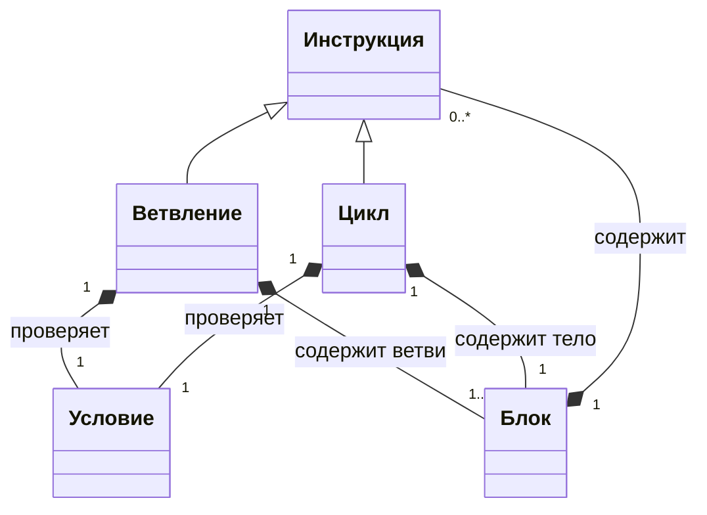
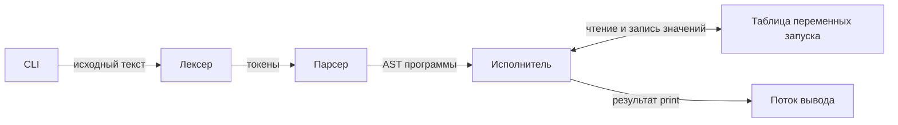

# ТЗ. Условия и циклы в MiniLang

## 1. Постановка задачи

Добавьте в C++ MiniLang две инструкции. `when … otherwise … end` выбирает, какую ветвь выполнить. `repeat while … end` повторяет блок, пока его условие истинно. Разрешите вкладывать обе инструкции друг в друга. Возможности описаны как требования к будущей реализации.

После выполнения задания должна работать такая программа.

```minilang
remember n = 0

repeat while n < 3
  when n == 1
    print "середина"
  otherwise
    print n
  end
  remember n = n + 1
end

print n
```

Ожидаемый вывод.

```text
0.0
середина
2.0
3.0
```

## 2. Сущности и связи

**Инструкция** задаёт одно действие программы. **Блок** содержит упорядоченную последовательность инструкций. **Условие** — выражение, которое при вычислении должно дать логическое значение. **Ветвление** содержит условие, первую ветвь и необязательную вторую ветвь. **Цикл** содержит условие и тело, которое можно выполнить несколько раз. Переменная связывает имя с текущим значением в пределах одного запуска программы.



## 3. Архитектура



Лексер распознаёт ключевые слова. Парсер проверяет границы блоков и рекурсивно разбирает вложенные инструкции. AST хранит условия и списки инструкций, которыми владеют узлы ветвления и цикла. Исполнитель обходит узлы через Visitor и по результату условия выбирает, какие вложенные инструкции выполнить. [Архитектура MiniLang](architecture.md)

## 4. Функциональные требования

### Синтаксис

`NEWLINE` и `EOF` обозначают токены перевода строки и конца файла. `expression` — существующее правило MiniLang. В EBNF квадратные скобки обозначают необязательную часть, а фигурные — ноль или более повторений.

```ebnf
program          = { NEWLINE | statement, NEWLINE }, [ statement ], EOF ;

statement        = remember-statement | print-statement
                 | when-statement | repeat-statement ;
remember-statement = "remember", IDENTIFIER, "=", expression ;
print-statement    = "print", expression ;

when-statement   = "when", expression, NEWLINE, body,
                   [ "otherwise", NEWLINE, body ], "end" ;
repeat-statement = "repeat", "while", expression, NEWLINE, body, "end" ;
body             = { NEWLINE | statement, NEWLINE } ;
```

- Распознавайте `when`, `otherwise`, `repeat`, `while` и `end` как ключевые слова только при полном совпадении с учётом регистра. Например, `when2` и `End` остаются идентификаторами. Точные ключевые слова становятся зарезервированными и больше не подходят для имён переменных.
- Заголовки `when условие` и `repeat while условие` завершаются переводом строки. `otherwise` и `end` занимают отдельные строки. Последний `end` верхнего уровня может стоять прямо перед EOF.
- Разрешите пустые строки, пустые тела и отсутствие `otherwise`. В каждом `when` допускается не более одной ветви `otherwise`. Отступы служат для читаемости. Границы определяются токенами.
- Применяйте существующие правила выражений. Например, перенос строки внутри условия вызывает синтаксическую ошибку. Лексер уже выдаёт один `Newline` и для LF, и для CRLF.

### Выполнение и переменные

| Действие | Ожидаемый результат |
|---|---|
| Выполнить `when` | Вычислить условие один раз. При `true` выполнить первую ветвь, при `false` — ветвь `otherwise`, если она есть. |
| Выполнить `repeat while` | Вычислить условие перед каждой итерацией. При `true` выполнить тело по порядку и снова проверить условие. При `false` перейти к следующей инструкции. Если первая проверка дала `false`, итераций будет ноль. |
| Получить условие другого типа | Сообщить об ошибке выполнения. Условие должно давать `bool`, например результат числового сравнения. `when 1` проходит синтаксический анализ, но вызывает ошибку выполнения. |
| Выполнить `remember` внутри блока | Создать или обновить имя в общей таблице запуска. Следующая проверка условия и инструкции после блока видят обновлённое значение. |
| Прочитать имя из пропущенного блока | Если имя появилось бы только при выполнении пропущенной ветви или тела, чтение вызывает существующую ошибку неизвестной переменной. |
| Обнаружить синтаксическую ошибку | Отклонить весь файл до выполнения первой инструкции. Это относится и к ошибкам в ветви с заведомо ложным условием. |
| Обнаружить ошибку выполнения | Остановить программу. Уже записанный вывод сохраняется. |

В рамках задания используются общая таблица переменных и цикл с проверкой условия перед входом. Счётные циклы, `break`, `continue`, локальные области видимости и литералы `true` и `false` относятся к отдельным расширениям.

## 5. Порядок реализации

### Шаг 1. Добавьте токены в лексер

1. Добавьте `When`, `Otherwise`, `Repeat`, `While` и `End` в `TokenType`.
2. В `Lexer::tokenize` найдите ветку состояния `ReadingWord`. По образцу `remember` и `print` сопоставьте токены с пятью новыми словами.
3. В `LexerTests` проверьте типы и лексемы ключевых слов, идентификаторы `when2` и `End`, а также строку `"end"`.

Все слова состоят из букв, поэтому их уже целиком читает существующий автомат. На этом шаге достаточно добавить распознавание полной лексемы после остановки в `ReadingWord`. [Типы токенов](../headers/token.h) · [Лексер](../sources/lexer.cpp) · [Тесты лексера](../tests/LexerTests.cpp)

### Шаг 2. Подготовьте узлы AST и Visitor

1. В `statements.h` объявите `ast::When` и `ast::RepeatWhile` как наследников `ast::Statement`.
2. Храните каждое условие в `ExpressionTree`, как выражение в узле `Print`. Для каждого тела используйте `Array<UniquePtr<ast::Statement>>`, как для программы целиком. У `When` два списка, у `RepeatWhile` один. Отсутствующий `otherwise` представьте пустым вторым списком.
3. Напишите конструкторы, которые перемещают полученные деревья и списки в поля узлов. По образцу `Print::accept` вызовите у посетителя `visit(*this)`.
4. Добавьте перегрузки `visit(const When&)` и `visit(const RepeatWhile&)` в `StatementVisitor`. Перед сборкой реализуйте новые методы у всех его наследников, включая тестовых посетителей. Реализация методов `Interpreter` описана в шаге 5.

За владение вложенными инструкциями отвечают списки с `UniquePtr`. За порядок посещения отвечает конкретный посетитель. При реализации исполнителя используйте шаг 5. [Узлы](../headers/statements.h) · [Реализации узлов](../sources/ast.cpp) · [Посетители](../headers/visitors.h)

### Шаг 3. Научите парсер разбирать `when`

Добавьте в `parseStatement` ветку `When`. Разберите условие через `parseEquality`, как в `print`, затем потребуйте `Newline`. Для тела удобно выделить общий метод, например `parseBody`. Он читает список инструкций и возвращает позицию первого непрочитанного токена. [Текущий парсер](../sources/parser.cpp)

1. При чтении тела пропускайте пустые строки. На допустимом маркере остановки верните список и позицию **на маркере**.
2. Для обычной инструкции вызовите `parseStatement` и потребуйте `Newline` на возвращённой позиции. В теле инструкция всегда находится перед маркером блока, поэтому используйте проверку перевода строки, а на EOF сообщайте об отсутствующем `end`.
3. Для первой ветви остановитесь перед `Otherwise` или `End`. Если встретился `Otherwise`, прочитайте его, потребуйте `Newline` и разберите вторую ветвь до `End`.
4. Потребуйте и прочитайте `End`. Верните `ParsedStatement` с узлом `When` и позицией **после `End`**. На верхнем уровне существующий `requireStatementEnd` проверяет, что дальше идёт перевод строки или EOF.

Если внутри первой ветви встречается вложенный `when`, его вызов `parseStatement` сам прочитает собственные `otherwise` и `end`. Внешний разбор получит готовый узел и продолжится с токена после внутреннего `end`. Для проверки разберите два вложенных `when` и убедитесь, что следующий за ними `print` находится на верхнем уровне AST.

### Шаг 4. Научите парсер разбирать `repeat while`

1. Добавьте в `parseStatement` ветку `Repeat` и потребуйте сразу после неё токен `While`.
2. Разберите условие через `parseEquality`, потребуйте `Newline` и используйте общий разбор тела с единственным допустимым маркером `End`.
3. Прочитайте `End` и верните узел `RepeatWhile` с позицией после маркера.
4. Проверьте сообщения об ошибках. Например, в цикле допустим `otherwise` вложенного `when`, который разбирается собственным вызовом. Если `otherwise` дошёл до разбора тела самого цикла, это синтаксическая ошибка. Так можно обнаружить пропущенный `end` цикла перед внешним `otherwise`.

Контракт разбора одинаков для обеих инструкций. Метод чтения тела оставляет курсор на маркере, а метод разбора инструкции читает собственный `end` и возвращает позицию после него. Проверяйте оба вида вложенности — ветвление в цикле и цикл в ветвлении. [Тесты парсера](../tests/ParserTests.cpp)

### Шаг 5. Реализуйте выполнение

1. В `Interpreter` выделите внутренний метод обхода списка инструкций. Он последовательно вызывает `statement->accept(*this)`. Используйте его в `execute`, в ветвях и в теле цикла. Публичный `execute` начинает новый запуск и сбрасывает переменные, поэтому для вложенного блока вызывайте именно внутренний обход.
2. Для проверки условия получите корень из `ExpressionTree` по образцу `Print`. Вызовите `evaluate` и извлеките `bool` через `std::get_if<bool>`. Если значение другого типа, сообщите об ошибке выполнения. Эту проверку можно использовать в обоих новых обработчиках.
3. В `visit(const ast::When&)` вычислите условие один раз и выполните выбранный список. Пустой список выполнится без действий.
4. В `visit(const ast::RepeatWhile&)` проверяйте условие перед каждым обходом тела. После успешного прохода вычислите условие заново, чтобы учесть изменившиеся переменные.
5. Используйте текущие обработчики `remember` и `print` в любом блоке. Они будут работать с таблицей переменных и потоком вывода текущего запуска.

[Интерфейс исполнителя](../headers/interpreter.h) · [Исполнитель](../sources/interpreter.cpp) · [Тесты исполнителя](../tests/InterpreterTests.cpp)

### Шаг 6. Проверьте результат

| Где | Что проверить |
|---|---|
| Лексер | Пять ключевых слов, точные лексемы, слова с префиксами ключевых слов, ключевое слово внутри строки. |
| Парсер | `when` с `otherwise` и без него, пустой блок, оба вида вложенности, следующая инструкция после `end`, последний `end` сразу перед EOF. |
| Ошибки парсера | Пропущенные условие, `while`, перевод строки или `end`. Лишние `otherwise` и `end` на верхнем уровне. Второй `otherwise` в одном `when`. `otherwise` на уровне тела цикла. |
| Ветвление | Оба значения условия, ложное условие без `otherwise`, условие неверного типа. Поместите `print missing` в невыбранную ветвь и убедитесь, что ошибки выполнения нет. |
| Цикл | Ноль итераций, несколько итераций, повторная проверка после изменения счётчика, условие неверного типа и остановка при ошибке в теле. В тестах с несколькими итерациями задайте изменение счётчика, которое приводит к выходу. |
| Переменные | Изменённое в цикле имя видно после `end`. Имя, созданное в выполненной ветви, доступно дальше. Чтение имени, которое создаётся только в пропущенной ветви, вызывает ошибку. |
| CLI | Программа из постановки печатает четыре ожидаемые строки и завершается с кодом `0`. Незакрытый блок даёт код `1` и диагностику синтаксического анализа в `stderr`, а числовое условие — код `1` и диагностику выполнения. |

Сборка и запуск тестов MiniLang без Qt выполняются из корня проекта.

```bash
cmake -S . -B /tmp/ds-build -DCMAKE_BUILD_TYPE=Release -DBUILD_GUI=OFF -DBUILD_TESTING=ON
cmake --build /tmp/ds-build --target InterpreterTests --parallel 2
ctest --test-dir /tmp/ds-build -L '^Interpreter$' --output-on-failure
```

Задание считается выполненным, когда обе инструкции работают отдельно и во вложенных блоках, контрольная программа печатает ожидаемый результат, а новые и существующие тесты MiniLang проходят. После реализации внесите правила в [спецификацию](specification.md) и опишите новые узлы и обход блоков в [архитектуре](architecture.md).
