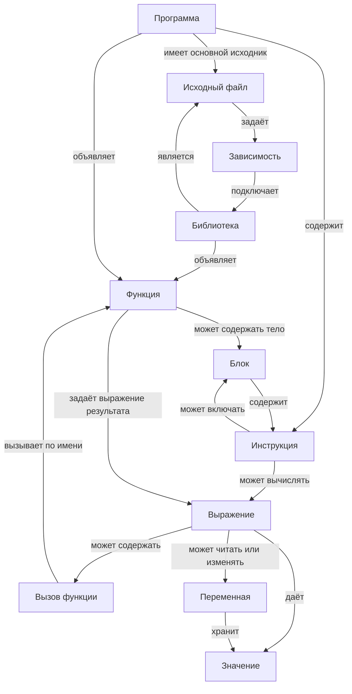
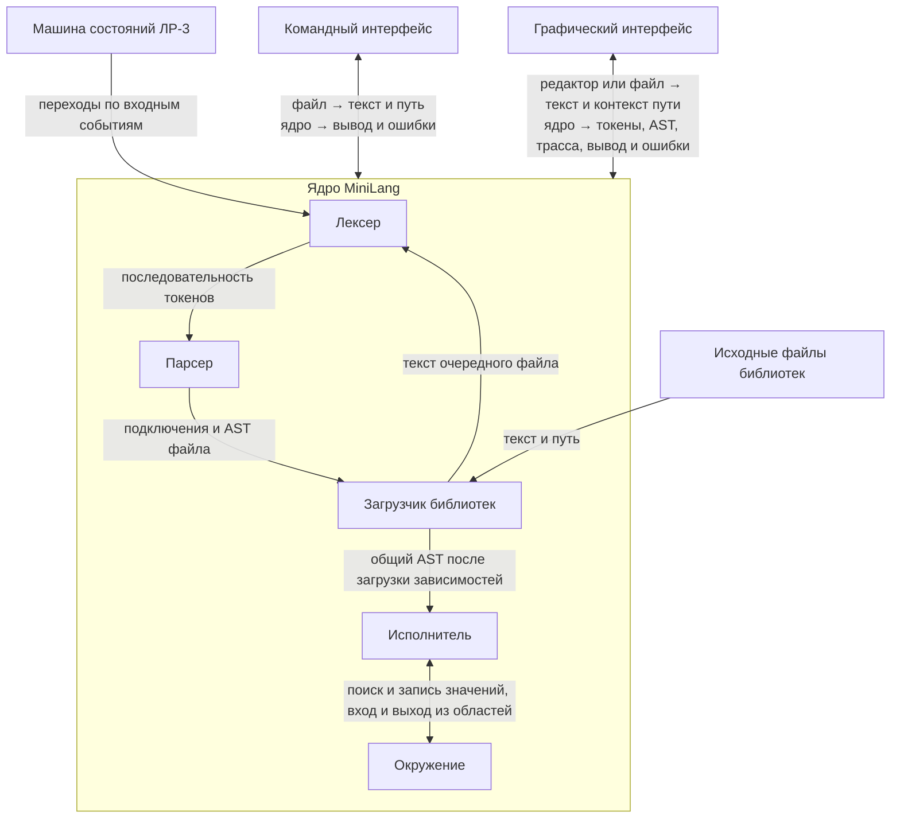

# Дизайн интерпретатора MiniLang на C++

Подключение библиотек через `using` реализовано в CLI и GUI. Ход работ отмечается в [плане добавления `using`](using-roadmap.md).

## 1. Постановка задачи

Разработать интерпретатор учебного языка MiniLang. Пользователь задаёт программу в виде текста. Интерпретатор проверяет её запись, вычисляет выражения, сохраняет значения в переменных, выполняет ветвления, циклы и вызовы функций. Результаты инструкций вывода доступны пользователю, а при ошибке интерпретатор сообщает этап и причину остановки.

MiniLang предназначен для небольших учебных задач, например подсчёта суммы в цикле, выбора результата по условию или вычисления факториала рекурсивной функцией. Программу можно запустить из файла в командной строке. В графическом интерфейсе можно также ввести текст, посмотреть результаты разбора и проследить порядок вычислений по шагам.

Для повторного использования функций программа может подключать библиотеки на MiniLang через `using "путь"`. Библиотека хранит объявления функций и может зависеть от других библиотек. Подготовка программы объединяет их объявления с инструкциями основного файла до начала выполнения.

## 2. Сущности и связи

| Сущность | Назначение |
|---|---|
| Программа | Упорядоченная последовательность инструкций и объявлений функций, подготовленная из основного исходника и подключённых библиотек. |
| Исходный файл | Текст MiniLang с путём, задающим каталог для относительных подключений. |
| Библиотека | Исходный файл, верхний уровень которого содержит подключения и объявления функций. |
| Зависимость | Направленная связь от исходного файла к библиотеке, заданная директивой `using`. |
| Инструкция | Действие программы. Инструкция может сохранить значение, изменить числовую переменную, вывести результат, выбрать ветвь или повторить блок. |
| Блок | Последовательность инструкций в ветви, теле цикла или теле функции. Блок может быть пустым. |
| Выражение | Запись, по которой вычисляется значение. Содержит литерал, имя переменной, бинарную операцию или вызов функции. |
| Переменная | Имя и связанное с ним текущее значение. Имя может принадлежать всей программе, вызову функции или счётчику цикла. |
| Значение | Число, строка или логическое значение. |
| Функция | Именованная часть программы с параметрами и выражением результата. Может содержать блок инструкций перед вычислением результата. |
| Вызов функции | Вычисление функции с конкретными аргументами. Каждый вызов имеет собственные параметры и локальные переменные. |

## 3. Архитектура

- **Командный и графический интерфейсы.** Оба запускают этапы общего ядра. Командный интерфейс читает файл, направляет вывод программы в стандартный поток вывода, а диагностику — в стандартный поток ошибок. Графический интерфейс принимает текст из редактора или файла и показывает результаты каждого пройденного этапа.
- **Загрузчик библиотек.** Получает основной текст и контекст пути, организует лексический и синтаксический анализ каждого файла. Обходит зависимости в глубину в порядке директив, помещает объявления зависимостей перед объявлениями подключающей библиотеки и добавляет инструкции основного файла. Активная цепочка в `Stack` обнаруживает циклы, таблица канонических путей в `Map` исключает повторные подключения. Основной файл также входит в активную цепочку, если его путь известен. Списки подключений и инструкций хранятся в `Array`. Состояние загрузки принадлежит одному запуску. При ошибке частично подготовленная программа освобождается.
- **Лексер.** Классифицирует входные символы и подаёт их как события детерминированной машине состояний ЛР-3. Переходы определяют границы лексем, а конечное состояние помогает выбрать тип токена или обнаружить ошибку. Последовательность токенов хранится в собственном массиве `Array`. Переводы строк и конец текста передаются парсеру как отдельные токены.
- **Парсер и AST.** Парсер рекурсивным спуском проверяет каждый файл и возвращает отдельные упорядоченные списки подключений и инструкций. Режим библиотеки разрешает на верхнем уровне объявления функций. Уровни разбора выражений задают приоритет операций, а рекурсивный разбор блоков связывает вложенные инструкции с внешней конструкцией. AST хранит упорядоченные списки инструкций и деревья выражений с уже определённой группировкой. Отрицательное число хранится в листе числового литерала вместе со знаком. Дерево выражения строится из листьев и бинарных узлов. Загрузчик объединяет AST файлов перемещением узлов. Собранная программа владеет узлами до завершения исполнения и использования представлениями GUI. Эту структуру используют исполнитель и средства просмотра программы.
- **Исполнитель.** Обходит AST через посетителей инструкций и выражений. Инструкции выбирают, какие блоки и выражения нужно вычислить, а выражения возвращают значения. Объявленные функции хранятся в таблице имён текущего запуска. Наблюдатель получает события входа в инструкцию или выражение и их успешного завершения. При завершении вычисления выражения он получает значение.
- **Окружение.** Глобальные переменные и переменные кадра хранятся в таблицах `Map` на основе красно-чёрного дерева. Области счётчиков активных `for` хранятся в массиве и просматриваются от внутренней к внешней. Кадры вызовов помещаются в `Stack`, поэтому вложенный вызов получает собственные параметры и локальные переменные. При выходе из вызова, в том числе по исключению, снимается его кадр.
- **Просмотр и пошаговый запуск.** Графический интерфейс строит представления инструкций, выражений и диаграмму AST по результату разбора. Из событий наблюдателя он собирает вложенную трассу исполнения. В пошаговом режиме исполнение идёт в рабочем потоке и ждёт команды продолжения или остановки на очередном событии. Окно показывает текущий узел и уже полученный вывод.

## 4. Функциональные требования

### Ввод и анализ программы

| Действие | Ожидаемое поведение |
|---|---|
| Запустить программу из файла | Командный интерфейс принимает один путь. При неверном числе аргументов он показывает подсказку, при недоступном файле сообщает причину ошибки. |
| Ввести программу в графическом интерфейсе | Пользователь может набрать или изменить текст в редакторе. Открытие читаемого файла загружает текст и запускает программу. |
| Распознать элементы записи | Лексер различает ключевые слова, имена, целые и дробные литералы, строки, операторы и разделители. LF и CRLF дают по одному токену перевода строки. Последний токен обозначает конец текста, в том числе для пустой программы. Неверная запись дроби, незакрытая строка и недопустимый символ вызывают лексическую ошибку. |
| Проверить грамматику | Парсер проверяет порядок токенов и границы блоков во всей программе и строит AST. Пустые строки и отсутствие перевода строки в конце допустимы. При лексической или синтаксической ошибке выполнение программы не начинается. |
| Подключить библиотеку | Начальные директивы `using` принимают непустые строковые пути. Между ними допустимы пустые строки. После первой инструкции или объявления функции и внутри блоков директива вызывает ошибку разбора. |
| Разрешить путь | Относительный путь отсчитывается от каталога подключающего файла, абсолютный используется напрямую. Текст редактора без пути использует выбранный базовый каталог. Отмена выбора отменяет запуск. |
| Подготовить зависимости | Каждая библиотека разбирается целиком и содержит подключения и объявления функций верхнего уровня. Один канонический путь загружается один раз за запуск. Цикл вызывает ошибку с цепочкой файлов. |
| Обработать ошибку подготовки | Ошибка чтения, разрешения пути, лексики или грамматики в любом исходнике останавливает подготовку до исполнения. Сообщение содержит путь проблемного файла и цепочку подключений. |

### Выполнение программы

| Действие | Ожидаемое поведение |
|---|---|
| Вычислить выражение | Исполнитель учитывает скобки и приоритет операций. Бинарные операнды вычисляются слева направо. Числовая арифметика возвращает число, сравнение — логическое значение. Деление на ноль и неподходящие типы операндов вызывают ошибку. |
| Прочитать или сохранить значение | Поиск имени идёт от ближайшего видимого счётчика к текущему кадру функции, затем к глобальным переменным. Чтение отсутствующего имени вызывает ошибку выполнения. `remember` вычисляет правую часть и записывает результат в ближайший одноимённый счётчик, текущий кадр или глобальную таблицу вне функции. При ошибке вычисления запись результата присваивания не выполняется. |
| Прочитать отрицательное число | Минус перед целым или дробным числом включается в числовой литерал AST. Например, `-5` и `-0.5` дают отрицательные значения, а `-0` сохраняет знак нуля. |
| Изменить числовую переменную | `++` и `--` изменяют существующую числовую переменную на единицу. Префиксная форма возвращает новое значение, постфиксная — прежнее. Инструкции `+=` и `-=` сохраняют сумму или разность. |
| Вывести значение | `print` записывает вычисленное значение и перевод строки. Строка выводится без внешних кавычек, логическое значение — как `true` или `false`. |
| Выбрать ветвь или повторить блок по условию | `when` вычисляет логическое условие один раз и выполняет выбранную ветвь, если она есть. `repeat while` проверяет логическое условие перед каждой итерацией и завершает цикл при ложном результате. |
| Повторить блок по диапазону | `for` один раз вычисляет допустимую целую границу и выполняет тело для значений локального счётчика от нуля до границы без её включения. При неположительной границе итераций нет. После выхода из цикла снова доступна одноимённая внешняя переменная, если она была. |
| Объявить и вызвать функцию | Объявление на верхнем уровне регистрирует функцию с момента выполнения. Вызов зарегистрированной функции с подходящим числом аргументов вычисляет их слева направо и создаёт отдельную область параметров и локальных переменных. Короткая форма вычисляет выражение результата сразу, многострочная — после выполнения тела. Вложенные и рекурсивные вызовы используют отдельные кадры. Повторное объявление, неизвестное имя функции, неверное число аргументов и превышение глубины вызовов вызывают ошибку. |
| Использовать библиотечную функцию | Объявления библиотек выполняются перед инструкциями основного файла. Все функции используют общую таблицу имён. Совпадение имён разных объявлений вызывает действующую ошибку выполнения. |
| Начать или завершить запуск | Каждый запуск начинает с пустых таблиц глобальных переменных и функций. Инструкции выполняются по порядку. Первая ошибка выполнения останавливает программу, уже записанный вывод сохраняется. |

### Просмотр и пошаговое выполнение

| Действие | Ожидаемое поведение |
|---|---|
| Просмотреть разбор | Графический интерфейс показывает токены основного текста с лексемами по порядку, включая `using`, инструкции с вложенными блоками, выражения и диаграмму AST. Дерево и диаграмма включают функции подключённых библиотек. Диаграмму можно перемещать и масштабировать. |
| Просмотреть выполнение | Интерфейс показывает вложенные вызовы исполнителя, значения вычисленных выражений и вывод `print`. |
| Выполнить следующий шаг или остановиться | Пошаговый режим приостанавливает исполнение на входе в инструкцию или выражение и при успешном возврате. Интерфейс выделяет текущий узел, показывает результат вычисленного выражения и продолжает исполнение по команде пользователя. При остановке остаются пройденная трасса и накопленный вывод. |
| Обработать ошибку или лимит выполнения | Интерфейс показывает причину остановки и сохраняет данные уже пройденных этапов. При исчерпании лимита событий входа в инструкции и выражения исполнение прерывается, накопленная трасса и вывод остаются доступны. |

[Спецификация языка](specification.md) · [Техническое описание архитектуры](architecture.md) · [Сборка и запуск из командной строки](../../README.md#обновление-команды-mini)
