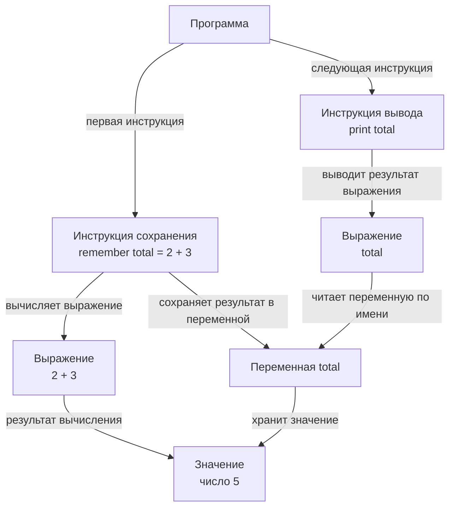
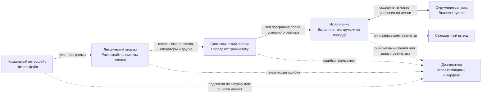

# Дизайн интерпретатора MiniLang

## 1. Постановка задачи

Разработать интерпретатор учебного языка MiniLang. Пользователь передаёт текстовую программу, которая вычисляет выражения, сохраняет значения под именами и выводит результаты. Интерпретатор выполняет программу и сообщает причину ошибки, если обработку нельзя продолжить.

MiniLang подходит для коротких последовательностей вычислений. Например, в одной инструкции можно вычислить стоимость заказа, в следующей сравнить её с заданным порогом, а затем вывести оба результата. Язык позволяет увидеть, как порядок операций и изменение переменных влияют на результат программы.

## 2. Сущности и связи

| Сущность | Описание |
|---|---|
| Программа | Последовательность инструкций, которую пользователь задаёт в текстовом файле. |
| Инструкция | Действие программы. Инструкция `remember` сохраняет значение под именем, а `print` выводит значение. |
| Выражение | Запись, по которой получается значение. Выражение может содержать литерал, имя переменной или операцию над двумя выражениями. Скобки задают группировку. |
| Переменная | Имя и связанное с ним текущее значение. Повторное сохранение меняет значение этого имени. |
| Значение | Число, строка или логический результат. |

В примере `remember total = 2 + 3` сохраняет число 5 под именем `total`, а `print total` читает это значение и выводит `5.0`.

## 3. Архитектура

Сплошные стрелки показывают ход обработки и обмен данными. Пунктирные стрелки ведут к диагностике, куда попадают подсказка по запуску и сообщения об ошибках.

**Командный интерфейс** получает путь к файлу, читает исходный текст и запускает этапы обработки. Он задаёт исполнителю стандартный вывод для записи результатов, а сообщения об ошибках выводит отдельно.

**Лексический анализ** читает текст слева направо и выделяет токены. Токен обозначает единицу записи языка, например имя, число или оператор. Лексер распознаёт имя целиком, прежде чем проверить, является ли оно ключевым словом. Из совпадающих записей оператора он выбирает более длинную, чтобы, например, отличать `<=` от `<`. Перевод строки и конец ввода сохраняются в последовательности как границы, нужные для разбора программы.

**Синтаксический анализ** проверяет порядок токенов и строит абстрактное синтаксическое дерево. Программа представлена упорядоченным списком инструкций с деревьями выражений. Листья дерева обозначают литералы и имена, а узел операции связывает два подвыражения. Разбор рекурсивным спуском использует отдельный уровень для каждой группы приоритетов и снова разбирает полное выражение внутри скобок. Цепочка операций одного уровня собирается слева направо. Дерево передаёт исполнителю готовую группировку операций.

**Исполнение** начинается после успешного анализа всей программы и проходит инструкции по порядку. Исполнитель получает значение числового литерала при обходе дерева выражения. Для операции он вычисляет левый и правый операнды и затем проверяет их типы. После успешного вычисления инструкция либо меняет окружение, либо записывает результат в заданный вывод.

**Окружение запуска** хранит соответствия между именами и текущими значениями. Такая структура позволяет искать переменную и заменять её значение по имени. Отдельное окружение для каждого запуска делает результат независимым от предыдущих запусков.

## 4. Функциональные требования

### Ввод и анализ программы

| Действие | Ожидаемое поведение |
|---|---|
| Запустить программу из файла | Командный интерфейс принимает один путь к файлу. При неверном числе аргументов он показывает подсказку по запуску. При ошибке чтения он сообщает причину и завершает обработку. |
| Распознать элементы записи | Интерпретатор различает ключевые слова, имена, целочисленные литералы, строки в двойных кавычках, операторы и скобки. Регистр имён и ключевых слов значим. Строковый литерал может быть пустым. Перенос до закрывающей кавычки вызывает лексическую ошибку. |
| Определить границы инструкций | На строке допускается не более одной инструкции. При разборе инструкции перенос там, где она должна продолжаться, вызывает синтаксическую ошибку, в том числе внутри скобок. Пустые строки и пустой файл допустимы. Последняя инструкция может закончиться без перевода строки. |
| Проверить программу перед запуском | Интерпретатор проверяет исходный текст целиком. Если встречается недопустимый элемент записи или нарушена грамматика, ни одна инструкция файла не выполняется. |

### Вычисление и выполнение

| Действие | Ожидаемое поведение |
|---|---|
| Вычислить выражение | Скобки задают группировку, затем по убыванию приоритета идут умножение и деление, сложение и вычитание, сравнения порядка, проверки равенства и неравенства. Операции одного приоритета группируются слева направо. |
| Получить значение числового литерала | Интерпретатор получает значение при вычислении выражения. Если оно выходит за поддерживаемый диапазон, выполнение останавливается на этой инструкции. |
| Применить оператор | Сначала вычисляется левый операнд, затем правый. После успешного вычисления обоих операндов интерпретатор проверяет их типы и применяет оператор. Арифметические операторы и операторы сравнения принимают два числа. Арифметика возвращает число, сравнение — логическое значение. Деление на ноль и неподходящий тип операнда вызывают ошибку выполнения. |
| Прочитать переменную | Имя в выражении даёт текущее значение переменной. Обращение к имени, которому ещё не назначено значение, вызывает ошибку выполнения. |
| Сохранить значение | `remember` сначала вычисляет выражение по текущим значениям переменных, затем создаёт или обновляет переменную. Новое значение может иметь другой тип. При ошибке вычисления прежнее состояние переменной сохраняется. |
| Вывести значение | `print` выводит успешно вычисленное значение с переводом строки. Строка выводится без внешних кавычек, логический результат — как `true` или `false`. Для пустой строки выводится только перевод строки. При ошибке вычисления вывод для этой инструкции не начинается. Сбой записи результата завершает запуск с ошибкой. |

### Требования к интерпретатору в целом

- Выполнять инструкции в порядке их записи. Каждый запуск начинается с пустого окружения.
- При первой ошибке выполнения останавливать программу. Результаты предыдущих инструкций, уже записанные в вывод, сохраняются.
- При ошибке чтения, анализа или выполнения сообщать этап и причину отдельно от результатов программы. Код завершения различает успешный запуск, ошибку обработки и неверное число аргументов.

Подробные правила языка и запуска приведены в [спецификации](specification.md) и [описании командного интерфейса](cli.md).
