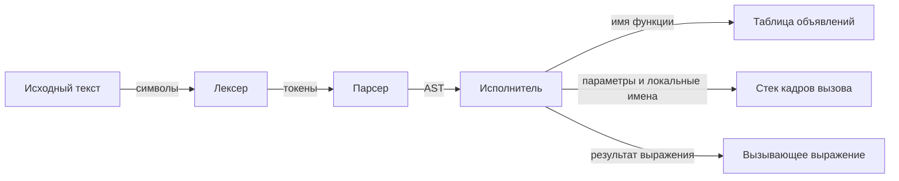

# Как добавить функции в MiniLang

Дорожная карта рассчитана на первый самостоятельный проход по лексеру, парсеру, AST и исполнителю. Начните с функции, которая возвращает одно выражение. Когда этот вариант заработает, добавьте многострочное тело с локальными переменными.

## Что должно получиться

```minilang
function add(a, b) -> a + b end
function twice(x) -> add(x, x) end

print twice(3 + 2) * 2
```

Результат — `20.0`. `a` и `b` — параметры объявления. `3 + 2` — аргумент вызова. Исполнитель вычисляет аргументы в окружении вызывающего кода, связывает полученные значения с параметрами и вычисляет тело в новом кадре вызова.

Выбранные правила для первой версии:

- Объявление `function имя(параметры) -> выражение end` занимает одну строку и стоит на верхнем уровне программы. Имя функции становится доступно после выполнения объявления. Функция может вызвать себя.
- Списки параметров и аргументов могут быть пустыми. Запятая разделяет элементы, завершающая запятая считается ошибкой. Имена параметров внутри одного объявления должны быть уникальны.
- Вызов — выражение. Его можно использовать в `print`, в правой части `remember`, в условиях, в арифметике и как аргумент другого вызова. Сначала проверяются имя и число аргументов, затем аргументы вычисляются слева направо.
- Параметры и локальные переменные принадлежат своему вызову. Функция может читать глобальные переменные. Локальные имена вызывающей функции и счётчики её циклов ей недоступны. Имена функций хранятся в отдельной таблице.
- Повторное объявление функции, вызов неизвестной функции, неверное число аргументов и превышение глубины вызовов дают ошибку выполнения. Предел в примере ниже — 128 активных вызовов.



Перед началом прочитайте разделы про парсер, AST, Visitor и окружение в [архитектуре MiniLang](architecture.md).

## 1. Добавьте токены

В [token.h](../headers/token.h) добавьте `Function`, `Arrow` и `Comma` в `TokenType`. В [lexer.cpp](../sources/lexer.cpp) добавьте точное совпадение со словом `function` в `State::ReadingWord`. Для запятой добавьте `case ','` в группу `SingleSymbol` в `classify` и верните `TokenType::Comma` из `singleSymbolType`.

Стрелку разберите тем же конечным автоматом, который читает `>=`. Добавьте `MinusSign` в [LexerEvent](../enums/lexerEvent.h) и `AfterMinus` в [LexerState](../enums/lexerState.h). В `classify` вынесите `case '-': return LexerEvent::MinusSign;` из группы `SingleSymbol`. Добавьте `Event::MinusSign` в `stringContentEvents`, чтобы минус внутри строки по-прежнему читался как её содержимое. В `makeLexerMachine` вставьте переходы рядом с переходами для операторов.

```cpp
machine.addTransition(State::Start, State::AfterMinus, Event::MinusSign);
machine.addTransition(State::AfterMinus, State::TwoCharOperator, Event::GreaterSign);
```

Добавьте `case '-': return TokenType::Arrow;` в `twoCharOperatorType`, а `case State::AfterMinus:` — к веткам `Lexer::tokenize`, вызывающим `singleSymbolType`. Готовый `case '-'` в `singleSymbolType` теперь обрабатывает минус без примыкающего `>`.

В [LexerTests.cpp](../tests/LexerTests.cpp) проверьте, что `function f(a,b)->a-b end` даёт `Function Identifier LeftParen Identifier Comma Identifier RightParen Arrow Identifier Minus Identifier End EndOfFile`. Отдельно проверьте `- >` как `Minus Greater`, `function2` как `Identifier` и `"a->b,c"` как один `String`.

## 2. Опишите два узла AST

| Узел | Где объявить | Какие поля добавить |
|---|---|---|
| `ast::Function : Statement` | [statements.h](../headers/statements.h) | `std::string name`, `Array<std::string> parameters`, `ExpressionTree result` |
| `ast::Call : Expr` | [expressions.h](../headers/expressions.h), рядом с остальными выражениями | `std::string name`, `Array<ExpressionTree> arguments` |

В `expressions.h` подключите `"Array/Array.h"` и используйте существующее предварительное объявление `class ExpressionTree;`. `Array` хранит элементы через указатель, поэтому этого объявления хватает для поля `arguments`. Определения конструктора и деструктора `Call` разместите в `ast.cpp`, где подключён полный тип `ExpressionTree`. Сам `expressionTree.h` уже подключает `expressions.h`, поэтому добавление обратного подключения создало бы цикл.

Вставьте объявление `Call` в `namespace ast` внутри `expressions.h`.

```cpp
struct Call : Expr {
  std::string name;
  Array<ExpressionTree> arguments;

  Call(std::string name, Array<ExpressionTree> arguments);
  ~Call() override;
  void accept(ExprVisitor& visitor) const override;
};
```

В [ast.cpp](../sources/ast.cpp) добавьте прямое подключение `"../headers/expressionTree.h"` и вставьте определения в `namespace ast`.

```cpp
Call::Call(std::string name, Array<ExpressionTree> arguments)
    : name(std::move(name)), arguments(std::move(arguments)) {}

Call::~Call() = default;

void Call::accept(ExprVisitor& visitor) const {
  visitor.visit(*this);
}
```

Конструктор `Function(std::string name, Array<std::string> parameters, ExpressionTree result)` напишите по образцу `ast::Remember`. Примите поля по значению и переместите их через `std::move`. В `Function::accept` вызовите `visitor.visit(*this)`. В [visitors.h](../headers/visitors.h) добавьте предварительные объявления обоих узлов и чисто виртуальные перегрузки `visit(const Call&)` в `ExprVisitor` и `visit(const Function&)` в `StatementVisitor`.

Добавьте перегрузки в `Interpreter`, `AstViews` из [MiniLangGui.cpp](../../GUI/source/MiniLangGui.cpp) и `RecordingVisitor` из [ParserTests.cpp](../tests/ParserTests.cpp). Иначе после изменения интерфейсов эти классы останутся абстрактными. На время работы над парсером тела перегрузок `Interpreter` могут выбрасывать `std::logic_error`. Для `RecordingVisitor` записывайте имя узла и обходите выражение результата или аргументы. К отображению в GUI вернитесь на шаге 6.

Вызов хранится в дереве как один узел через `ExpressionTree::makeLeaf`. У каждого его аргумента своё дерево. Например, у `add(1, 2 * 3)` два дерева аргументов, а размер внешнего `ExpressionTree` равен единице. Обход аргументов выполняет посетитель `Call`.

## 3. Научите парсер читать объявление и вызов

```ebnf
function = "function", IDENTIFIER, "(", [ parameters ], ")", "->", expression, "end" ;
parameters = IDENTIFIER, { ",", IDENTIFIER } ;
call = IDENTIFIER, "(", [ arguments ], ")" ;
arguments = expression, { ",", expression } ;
```

**Объявление напишите сами.** Добавьте в закрытую часть [parser.h](../headers/parser.h) статический `parseFunction` с той же сигнатурой и типом результата, что у `parseStatement`. В основном цикле `Parser::parse` направьте `TokenType::Function` в `parseFunction`, остальные инструкции — в `parseStatement`. `parseBody` продолжит вызывать `parseStatement`, поэтому вложенные объявления будут отклоняться.

В [parser.cpp](../sources/parser.cpp) используйте `requireToken` для имени и скобок. Сначала проверьте, начинается ли список с `)`. Если список непустой, читайте `Identifier`, проверяйте повтор имени проходом по `Array<std::string>` и после запятой требуйте следующий `Identifier`. После `)` потребуйте `Arrow`, разберите результат через `parseEquality` и потребуйте `End` на позиции `result.nextPosition`. Верните `ParsedStatement` с `UniquePtr<ast::Statement>` на новый `ast::Function` и позицией сразу после `End`. Перевод строки или EOF проверит общий цикл `parse`.

**Вызов можно вставить.** В начало `Parser::parsePrimary`, перед разбором скобок, добавьте этот блок. Он предполагает конструктор `Call(std::string, Array<ExpressionTree>)`. `parseEquality` читает аргумент до запятой или закрывающей скобки и сам обрабатывает вложенные вызовы через `parsePrimary`.

```cpp
if (position < tokens.size() && tokens[position].type == TokenType::Identifier &&
    position + 1 < tokens.size() && tokens[position + 1].type == TokenType::LeftParen) {
  Array<ast::ExpressionTree> arguments;
  std::size_t next = position + 2;
  if (next < tokens.size() && tokens[next].type != TokenType::RightParen) {
    while (true) {
      auto argument = parseEquality(tokens, next);
      arguments.push_back(std::move(argument.expression));
      next = argument.nextPosition;
      if (next >= tokens.size() || tokens[next].type != TokenType::Comma) break;
      ++next;
    }
  }
  requireToken(tokens, next, TokenType::RightParen, "Ожидалась закрывающая скобка вызова");

  return {
    .expression = ast::ExpressionTree::makeLeaf(
      UniquePtr<ast::Expr>(new ast::Call(tokens[position].lexeme, std::move(arguments)))),
    .nextPosition = next + 1
  };
}
```

В `ParserTests.cpp` разберите `print 2 * add(3, id(4))`. Корень выражения — `Binary` с операцией `Star`, справа — `Call` с двумя аргументами, второй аргумент — ещё один `Call`. Проверьте также `f()`, `f(1,)`, `f(,1)`, незакрытую скобку, повтор параметра, отсутствие `end` и объявление внутри `when`.

## 4. Изолируйте переменные вызова

В [environment.h](../headers/environment.h) добавьте `"Stack/stack.h"` и `<cstddef>`. В открытой части `Environment` объявите метод рядом с `withLoopVariable`.

```cpp
template<typename Run>
Value withFunctionScope(const Array<std::string>& parameters,
                        const Array<Value>& arguments, Run&& run);
```

В закрытой части добавьте кадр и стек. Кадр владеет таблицей параметров и локальных переменных. Индекс `firstLoopScope` задаёт границу в существующем массиве счётчиков `localScopes`. Кадр захватывает её до входа в функцию, поэтому видит только циклы, открытые внутри данного вызова.

```cpp
struct CallFrame {
  Variables locals;
  std::size_t firstLoopScope;
  std::size_t depth;

  CallFrame(std::size_t firstLoopScope, std::size_t depth)
    : firstLoopScope(firstLoopScope), depth(depth) {}
  CallFrame(const CallFrame&) = delete;
  CallFrame(CallFrame&&) = default;
};

Stack<CallFrame> callFrames;
```

В [environment.tpp](../headers/environment.tpp) добавьте `#include <stdexcept>` и вставьте реализацию внутри `namespace minilang`. Защитный объект снимает кадр и при обычном возврате, и при исключении из тела. До установки защитного объекта в стеке ещё нет нового кадра либо `push` уже завершился успешно.

```cpp
template<typename Run>
Environment::Value Environment::withFunctionScope(
    const Array<std::string>& parameters, const Array<Value>& arguments, Run&& run) {
  constexpr std::size_t maxDepth = 128;
  const std::size_t depth = callFrames.empty() ? 1 : callFrames.top().depth + 1;
  if (depth > maxDepth) {
    throw std::invalid_argument("Ошибка выполнения: превышена глубина вызовов функций");
  }

  CallFrame frame(localScopes.size(), depth);
  for (std::size_t i = 0; i < parameters.size(); ++i) {
    frame.locals.insert(parameters[i], arguments[i]);
  }
  callFrames.push(std::move(frame));

  struct PopFrame {
    Stack<CallFrame>& frames;
    ~PopFrame() { frames.pop(); }
  } guard{callFrames};

  return std::forward<Run>(run)();
}
```

Этот метод вызывается после проверки числа аргументов на шаге 5. Для поиска имён внесите три изменения в [environment.cpp](../sources/environment.cpp).

1. В `findLocalScope` вычислите нижнюю границу `const std::size_t first = callFrames.empty() ? 0 : callFrames.top().firstLoopScope;`. В условии цикла замените `i > 0` на `i > first`.
2. В `lookup` сразу после проверки `findLocalScope` ищите имя в `callFrames.top().locals`, если стек непуст. При совпадении верните `locals.at(name)`. Затем оставьте обычный поиск в глобальной таблице.
3. В `assign` после обновления существующего счётчика выберите целевую таблицу через `auto& target = callFrames.empty() ? variables : callFrames.top().locals;`. В последних двух строках используйте `target` для `containsKey`, `replace` и `insert`. Это позволит `remember` внутри функции сохранять новое имя в текущем кадре, даже если такое имя есть среди глобальных.

## 5. Выполните объявление и вызов

В закрытой части [interpreter.h](../headers/interpreter.h) объявите `using FunctionTable = Map<std::string, const ast::Function*>;` и поле `FunctionTable* functions = nullptr;`. В [interpreter.cpp](../sources/interpreter.cpp) создайте локальную `FunctionTable declarations;` в начале `Interpreter::execute` и установите `functions = &declarations;` рядом с назначением `output` и `observer`. Сбрасывайте `functions` в `nullptr` в обоих местах, где сбрасывается `output`. Указатели в таблице заимствованы из AST, который живёт до завершения `execute`.

`visit(const ast::Function& node)` напишите сами. Проверьте, что таблица доступна, как `visit(Print)` проверяет поток. Если `functions->containsKey(node.name)`, выбросьте `std::invalid_argument` с именем повторной функции. Иначе вставьте `node.name` и `&node` через `insert`. Объявление регистрирует функцию. Вычисление результата происходит только при вызове.

Вставьте эту реализацию вместо временной перегрузки для `ast::Call`.

```cpp
void Interpreter::visit(const ast::Call& node) {
  if (!functions || !functions->containsKey(node.name)) {
    throw std::invalid_argument("Ошибка выполнения: неизвестная функция: " + node.name);
  }
  const auto& function = *functions->at(node.name);
  if (function.parameters.size() != node.arguments.size()) {
    throw std::invalid_argument("Ошибка выполнения: неверное число аргументов: " + node.name);
  }

  Array<Value> arguments;
  for (std::size_t i = 0; i < node.arguments.size(); ++i) {
    arguments.push_back(evaluate(*node.arguments[i].getRoot()));
  }

  lastValue = environment.withFunctionScope(function.parameters, arguments, [&] {
    return evaluate(*function.result.getRoot());
  });
}
```

`evaluate` использует общее поле `lastValue`. Поэтому цикл сразу сохраняет каждый результат в `arguments`, а присваивание в `lastValue` происходит после завершения вложенного вычисления. Вставка рассчитана на непустые деревья из парсера. Если вручную собираете AST в тестах, перед разыменованием корней добавьте проверки по образцу `visit(Remember)`.

## 6. Проверьте CLI, тесты и GUI

Сохраните программу из начала документа во временный файл `/tmp/minilang-functions.mini`. Для CLI и тестов интерпретатора подойдёт следующая сборка.

```sh
cmake -S . -B /tmp/ds-build -DCMAKE_BUILD_TYPE=Release -DBUILD_GUI=OFF -DBUILD_TESTING=ON
cmake --build /tmp/ds-build --target MiniLangCpp InterpreterTests --parallel 2
/tmp/ds-build/MiniLangCpp /tmp/minilang-functions.mini
ctest --test-dir /tmp/ds-build -L Interpreter --output-on-failure
```

Добавьте проверки в [InterpreterTests.cpp](../tests/InterpreterTests.cpp).

| Случай | Ожидаемое поведение |
|---|---|
| `function id(x) -> x end`, затем `print id(id("ok"))` | `ok` |
| Глобальная `x = 9`, функция `id(x) -> x`, вызов `id(2)`, затем вывод `x` | `2.0`, затем `9.0` |
| `function read() -> i end`, затем `print read()` внутри `for i in range(1)` без глобальной `i` | Ошибка неизвестной переменной `i` |
| Вызов до объявления или повторное объявление | Ошибка выполнения с именем функции |
| `id(1 / 0, 2)` при одном параметре | Ошибка числа аргументов до вычисления деления |
| `function loop() -> loop() end`, затем `print loop()` | Ошибка глубины вызовов |
| Ошибка внутри функции, после неё новый `execute` на том же объекте `Interpreter` | Новый запуск выполняется с пустой таблицей функций и без старых параметров |

В `MiniLangGui.cpp` добавьте имена токенов в `tokenName`. В `AstViews::visit(Function)` используйте `addStatement` и `addExpression` по образцу `Remember`. В `AstViews::visit(Call)` подпишите узел через `addExprNode` и добавьте по дочернему узлу через `addExpressionChild` на каждое дерево аргумента. Сохраните указатель на родителя до обхода, как в `visit(Binary)`. Трасса возьмёт подписи из дерева по адресам узлов. Трасса получает вход в функцию как часть вычисления `Call`, потому что тело тоже проходит через `evaluate`. Пересоберите с `BUILD_GUI=ON` при наличии Qt 6 и проверьте дерево и пошаговое выполнение примера.

## 7. Добавьте многострочное тело

Когда однострочная форма заработает, добавьте второй вариант с переводом строки после стрелки. Здесь `return` — обязательная последняя строка тела на уровне самой функции.

```minilang
function factorial(n) ->
  remember result = 1
  when n > 1
    remember result = n * factorial(n - 1)
  end
  return result
end

print factorial(5)
```

Результат — `120.0`. Каждый вызов хранит собственные `n` и `result`.

1. Добавьте токен `Return` и точное ключевое слово `return`, как на шаге 1. Добавьте в `ast::Function` поле `Array<UniquePtr<Statement>> body`. Для короткой формы передавайте пустой массив.
2. В `parseFunction` посмотрите на токен после `Arrow`. Если это `Newline`, вызовите `parseBody` с позиции после перевода строки и маркерами `{TokenType::Return, TokenType::End}`. На возвращённой позиции потребуйте `Return`, разберите следующее выражение через `parseEquality`, затем потребуйте `Newline`. На следующей непустой строке потребуйте `End`. Если `parseBody` вернул позицию на `End`, сообщите, что отсутствует итоговый `return`. При короткой форме сохраняйте разбор из шага 3.
3. В готовой вставке из шага 5 добавьте `executeStatements(function.body);` в лямбду перед `return evaluate(...)`. Инструкции и итоговое выражение используют один кадр. Отдельный узел `Return` для этой грамматики не нужен. Поскольку `parseStatement` не обрабатывает `Return`, он будет отклонять его внутри `when`, циклов и за пределами функции.
4. В GUI обойдите `body` по образцу тела цикла. Проверьте факториал, сохранение глобальной переменной при одноимённом `remember` внутри функции, вызов из цикла с передачей счётчика явным аргументом, отсутствие `return` и ошибки в теле. После реализации перенесите принятые правила в [спецификацию языка](specification.md).

Если понадобится ранний `return` внутри ветки или цикла, выделите его в отдельный этап. Понадобится сигнал завершения, который проходит через вложенные списки инструкций до текущего вызова. Проверьте, что выход из цикла очищает счётчик и что наблюдатель получает завершение каждой покинутой инструкции.
