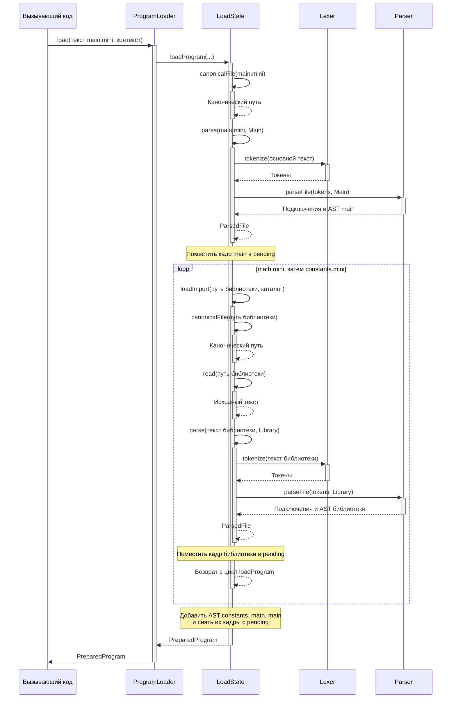
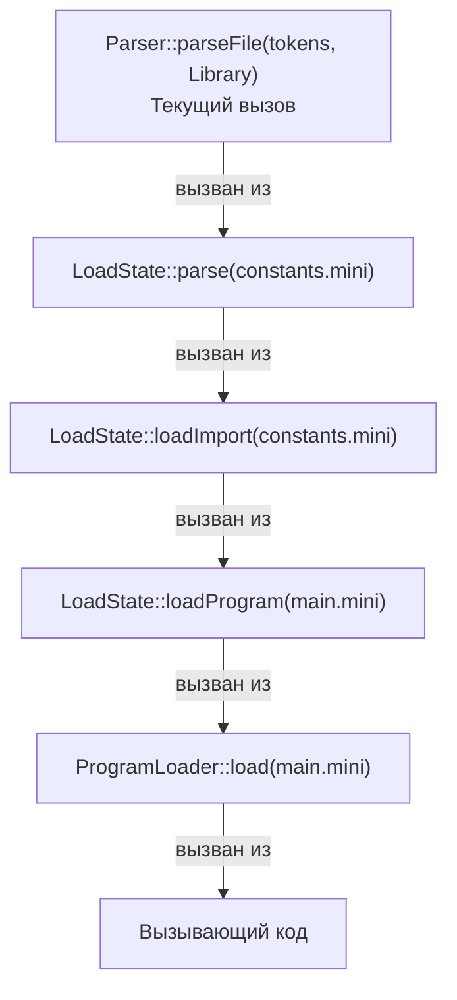
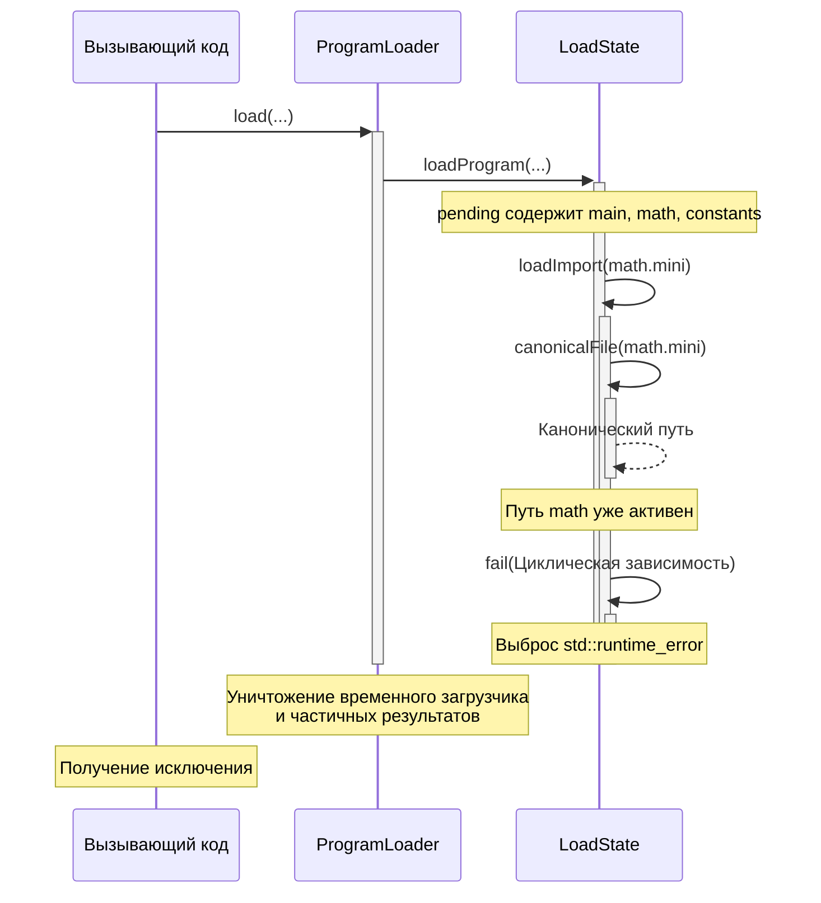

# Вызовы методов загрузчика MiniLang

Схемы составлены по текущей реализации `ProgramLoader` и `LoadState`. Пример показывает подготовку текста через API ядра. [Реализация загрузчика](../sources/loader/programLoader.cpp)

## Пример входных файлов

Для вызова `ProgramLoader::load` передаются текст `main.mini` и `LoadContext` с путём этого файла. Все три файла находятся в одном каталоге.

`main.mini`

```minilang
using "math.mini"
print square(5)
```

`math.mini`

```minilang
using "constants.mini"
function square(x) -> x * x * factor() end
```

`constants.mini`

```minilang
function factor() -> 2 end
```

## Порядок вызовов

Диаграмма показывает вызовы сверху вниз. Обращения `LoadState` к себе обозначают вызовы его вспомогательных методов. `read` завершается перед входом в `parse`, поскольку его результат передаётся аргументом.



После каждого `loadImport` управление возвращается в цикл `loadProgram`. Цикл берёт верхний `FileFrame` из `pending` и продолжает обработку его подключений. Поэтому глубина вызовов методов загрузчика остаётся ограниченной при увеличении длины цепочки библиотек.

## Снимок стека вызовов

Во время разбора `constants.mini` активные вызовы расположены следующим образом. Самый глубокий вызов указан сверху. Внутренние вызовы парсера опущены.



К этому моменту `loadImport(math.mini)` уже завершился. Состояние `math.mini` сохраняется в `pending` и ожидает завершения зависимости.

## Состояние стека файлов

В таблице стек `pending` записан от основания к вершине. После возврата `parse(constants.mini)` кадр библиотеки помещается на вершину.

| Момент | `pending` | Общий список `program.statements` |
|---|---|---|
| Основной текст разобран | `main` | Пусто |
| `loadImport(math)` завершён | `main → math` | Пусто |
| `loadImport(constants)` завершён | `main → math → constants` | Пусто |
| `constants` обработан и снят | `main → math` | `Function factor` |
| `math` обработан и снят | `main` | `Function factor`, `Function square` |
| `main` обработан и снят | Пусто | `Function factor`, `Function square`, `Print square(5)` |

При снятии кадра загрузчик отмечает его канонический путь как успешно загруженный и удаляет последнее имя из `chain`. После опустошения стека возвращается `PreparedProgram`. Последующий вызов `Interpreter::execute` с этим AST выведет `50.0`.

## Вызовы при ошибке

Если `constants.mini` содержит `using "math.mini"`, очередной вызов `loadImport` обнаружит активный путь и вызовет `fail`.



Сообщение содержит цепочку `main.mini → math.mini → constants.mini → math.mini` с полными путями. Исключение выходит через `loadImport`, `loadProgram` и `load`. Временный объект загрузчика уничтожается вместе со стеками, таблицей путей и частичным AST.

Ошибки открытия и чтения вызывают `fail` из `read`. Лексическая или синтаксическая ошибка вызывает `fail` из `parse` после перехвата ошибки соответствующего анализатора.

[Дизайн загрузчика](loader-design.md)
