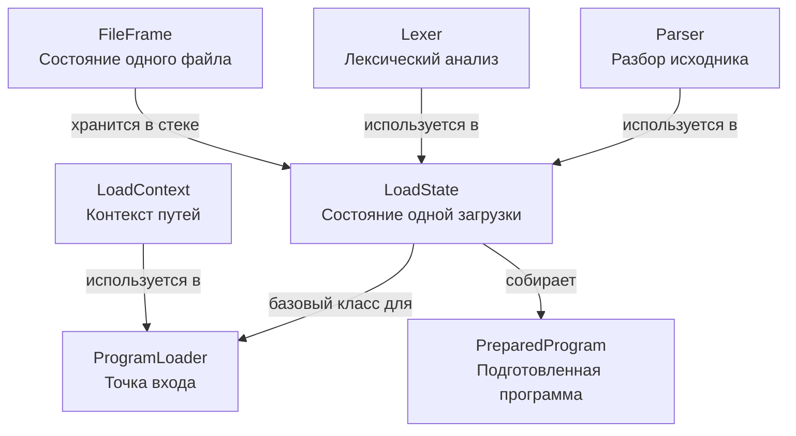
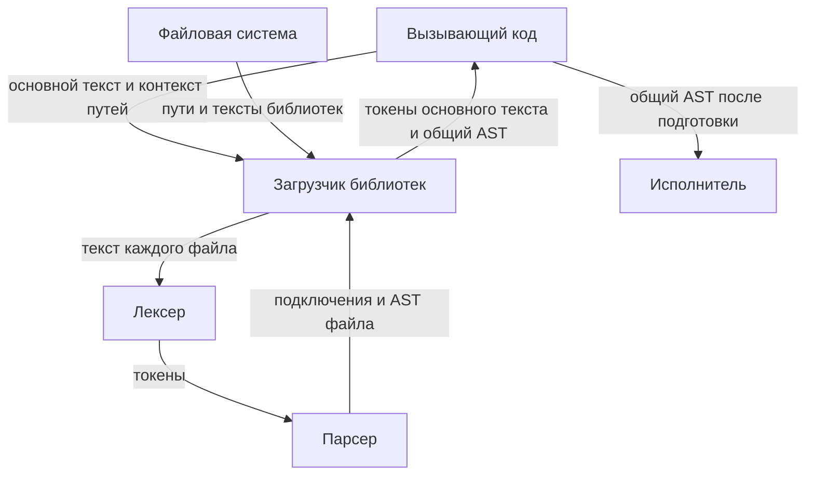

# Дизайн загрузчика библиотек MiniLang

## 1. Постановка задачи

Реализовать загрузчик, который принимает основной текст MiniLang и подготавливает программу с подключёнными библиотеками. Директива `using` задаёт путь к библиотеке. Библиотека содержит объявления функций и может подключать другие библиотеки.

Загрузчик нужен для повторного использования функций в разных программах. Он читает зависимости, проверяет их запись и собирает объявления перед инструкциями основного текста. Результат подготовки передаётся исполнителю.

Загрузчик реализован в `MiniLangCore` и используется в CLI и GUI. [План добавления `using`](using-roadmap.md)

## 2. Сущности и связи

| Класс или структура | Назначение |
|---|---|
| `LoadContext` | Задаёт путь основного файла либо базовый каталог для текста без пути. Позволяет разрешать относительные подключения. |
| `PreparedProgram` | Хранит токены основного текста и владеет общим AST с объявлениями библиотек и инструкциями программы. |
| `FileFrame` | Хранит путь, каталог, результат разбора одного файла и позицию следующего подключения. Позволяет продолжить обработку после подготовки зависимости. |
| `LoadState` | Хранит состояние одной загрузки и выполняет обход зависимостей, проверку путей и объединение AST. |
| `ProgramLoader` | Предоставляет точку входа для подготовки программы. Наследует `LoadState` через `protected` и создаёт отдельный объект на каждый вызов загрузки. |
| `Lexer` | Преобразует текст очередного исходника в токены. |
| `Parser` | Отделяет список подключений от AST и проверяет допустимое содержимое основного файла или библиотеки. |

## 3. Архитектура

### Контекст путей

- Основной текст передаётся вызывающим кодом. Это позволяет подготовить текущие изменения редактора.
- При заданном пути основного файла загрузчик канонизирует его и определяет каталог подключений. Для текста без пути используется переданный базовый каталог.
- Относительный путь зависимости разрешается от каталога подключающего файла. Вложенные подключения используют каталог канонического пути библиотеки. Абсолютный путь используется напрямую.

### Состояние загрузки

- `ProgramLoader` наследует защищённые поля и методы `LoadState`. Статическая точка входа создаёт временный объект загрузчика. Его состояние освобождается при возврате результата или исключении.
- Незавершённые файлы хранятся в собственном `Stack<FileFrame>`. На вершине находится файл, чьи подключения обрабатываются сейчас. Индекс следующего подключения сохраняет позицию продолжения.
- `Map<std::string, bool>` хранит канонические пути. Значение `false` обозначает активный файл, `true` — файл, чьи зависимости и объявления уже добавлены в программу.
- `Array<std::string>` хранит цепочку имён файлов для диагностики. В начало помещается основной файл либо обозначение текста редактора.

### Обход зависимостей

- Сначала загрузчик разбирает основной текст целиком и помещает его кадр в стек. Основной файл с известным путём регистрируется как активный.
- Для очередной директивы загрузчик разрешает и канонизирует путь. Активный путь вызывает ошибку цикла. Успешно загруженный путь пропускается.
- Новая библиотека читается и разбирается целиком. Её кадр помещается на вершину стека, после чего основной цикл продолжает обработку с этой библиотеки.
- Когда подключения файла обработаны, его инструкции перемещаются в общий AST в исходном порядке. Файл отмечается загруженным, его кадр и имя снимаются со стека и цепочки.
- Обход в глубину помещает объявления зависимостей перед объявлениями подключающей библиотеки. Инструкции основного текста добавляются последними.

### Анализ и владение результатом

- Лексер и парсер применяют общие правила MiniLang. Для библиотеки выбирается режим, разрешающий на верхнем уровне подключения и объявления функций.
- Узлы AST принадлежат `UniquePtr`, списки хранятся в `Array`. Объединение перемещает узлы в `PreparedProgram`.
- Вызывающий код владеет результатом до завершения исполнения и использования AST представлениями GUI. Токены основного текста сохраняются для отображения.
- Ошибка чтения, пути, лексики или грамматики прерывает подготовку. Диагностика указывает этап, путь, причину и цепочку подключений. Частичные результаты освобождаются при выходе из загрузчика.

## 4. Функциональные требования

| Действие | Ожидаемое поведение |
|---|---|
| Подготовить основной текст | Принять текст и необязательный контекст путей. Вернуть токены основного текста и общий AST. Пустой текст допустим. |
| Проверить контекст | Одновременное указание пути основного файла и базового каталога вызывает ошибку. Относительное подключение требует одного из этих значений. |
| Подключить библиотеку | Прочитать файл и разобрать его вместе с вложенными зависимостями. Пустая библиотека допустима. Исполняемая инструкция верхнего уровня библиотеки вызывает ошибку разбора. |
| Разрешить путь | Использовать каталог подключающего исходника для относительного пути, абсолютный путь использовать напрямую. Сообщать об отсутствующем файле, недоступном файле, каталоге вместо файла и пути с нулевым байтом. |
| Обработать повтор | Подключить каждый канонический путь один раз за загрузку, включая обращения через символические ссылки. |
| Обнаружить цикл | Остановить подготовку и показать замкнутую цепочку файлов. Учитывать самоподключение и возврат к основному файлу. |
| Сохранить порядок | Обрабатывать директивы сверху вниз, зависимости добавлять перед подключающим файлом, инструкции каждого файла сохранять в исходном порядке. |
| Передать функции исполнителю | Сохранить объявления в общем AST. Совпадения имён проверяются исполнителем по действующим правилам языка. |
| Повторить загрузку | Создать новое состояние, заново прочитать библиотеки и учесть изменения файлов. Предыдущий результат остаётся самостоятельным. |
| Обработать ошибку | Завершить подготовку с диагностикой, освободить частичный AST и временное состояние. |

[Последовательность вызовов и состояние стека](loader-call-flow.md) · [Спецификация подключений](specification.md#подключение-библиотек-через-using)
