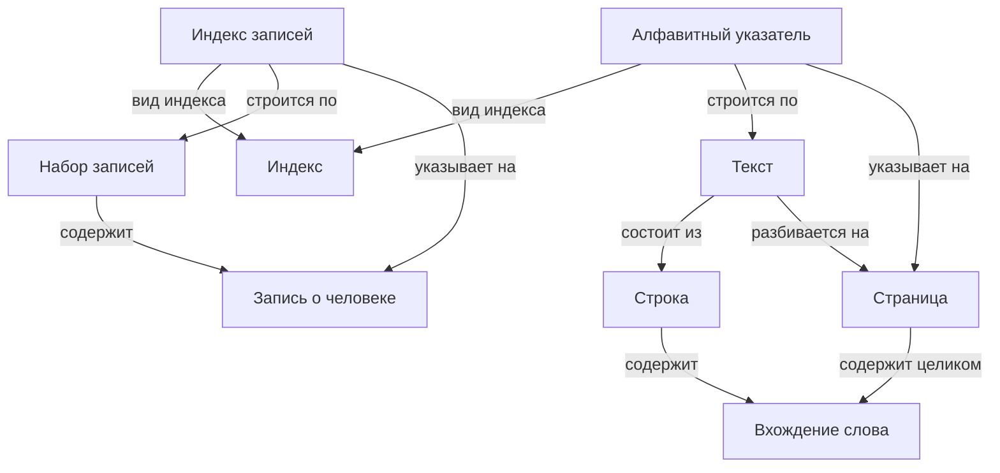
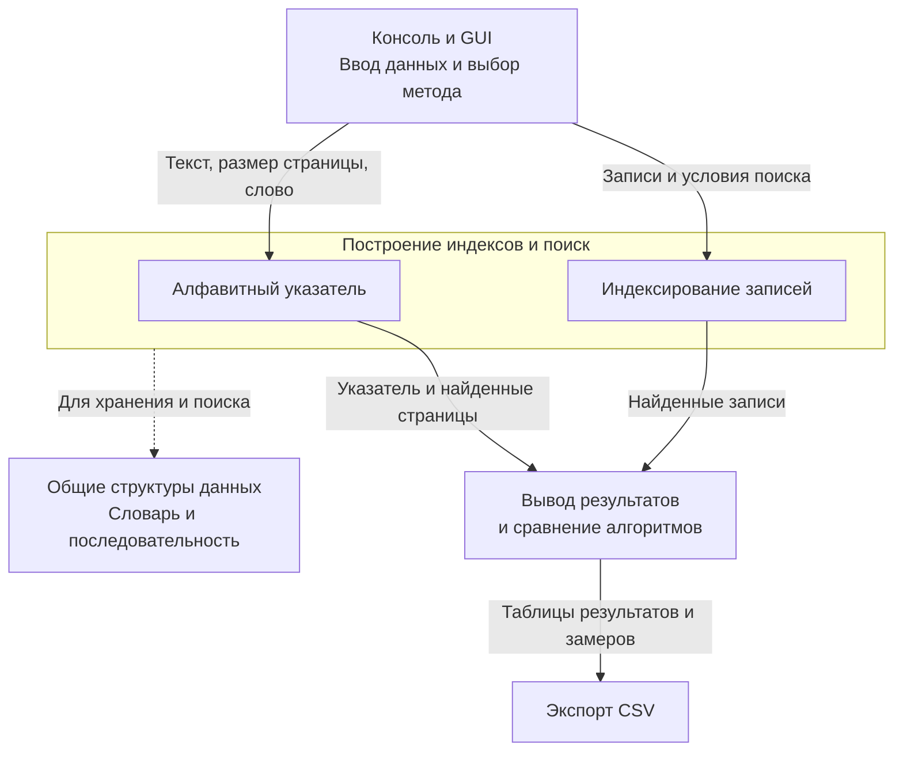

# Дизайн лабораторной работы № 2

## 1. Постановка задачи

Разработать программу для построения индексов и сравнения алгоритмов поиска на одинаковых данных.

- **Алфавитный указатель.** Разбить текст на страницы заданного размера в символах с учётом границ строк. Для каждого слова указать страницы, на которых оно встречается. Указатель позволяет найти нужное место в многостраничном тексте по слову.
- **Индексирование записей о людях.** Найти все записи с заданными именем, фамилией и годом рождения либо выбрать записи за заданный диапазон годов. Индексы подходят для повторных запросов к одному набору записей.

Для слова сравниваются бинарный поиск в упорядоченной последовательности и поиск в красно-чёрном дереве. Для диапазона годов сравниваются поиск по индексу и полный просмотр исходных записей.

Обе задачи доступны в консоли и в графическом интерфейсе (GUI). В графическом интерфейсе можно загрузить текст из файла, просмотреть страницы указателя и редактировать таблицу записей о людях.

## 2. Сущности и связи

| Сущность | Описание |
|---|---|
| Текст | Упорядоченная последовательность исходных строк. |
| Строка | Часть текста между переносами. Содержит ноль или более вхождений слов. |
| Вхождение слова | Отдельное употребление слова в тексте. Одно и то же слово может встречаться несколько раз, в том числе на одной странице. |
| Страница | Фрагмент текста, содержащий целые вхождения слов. |
| Набор записей | Коллекция записей о людях, в которой выполняется поиск. |
| Запись о человеке | Отдельная запись со сведениями об одном человеке. |
| Индекс | Общий тип поисковых указателей, связывающих ключи с результатами поиска. |
| Алфавитный указатель | Вид индекса, который связывает слова со страницами текста. |
| Индекс записей | Вид индекса, который связывает ключи поиска с группами записей о людях. |

## 3. Архитектура

### Актуальность индексов

В GUI индекс строится по явной команде и используется для повторных запросов. Изменение текста, размера страницы или набора записей сбрасывает индекс. Это предотвращает поиск по прежним страницам или записям и позволяет измерять построение отдельно от поиска.

### Алфавитный указатель

- **Разбиение текста.** При добавлении слова на непустую страницу перед ним ставится перенос, если оно начинало исходную строку, и пробел в остальных случаях. Этот знак учитывается при проверке вместимости.
- **Список страниц без повторов.** Список для слова пополняется по ходу разбиения текста. Номера страниц поступают по возрастанию, поэтому достаточно сравнить текущий номер с последним добавленным.
- **Общие данные для двух способов поиска.** При построении указателя новые слова добавляются в красно-чёрное дерево по мере появления. Из дерева один раз получают отсортированный массив для вывода и бинарного поиска. Дерево сохраняется для второго способа поиска, поэтому оба метода работают с одинаковыми списками страниц.

| Страница | Предельное заполнение |
|---|---:|
| Первая | ½ заданного размера |
| Каждая десятая | ¾ заданного размера |
| Остальные | Заданный размер |

Лимиты округляются вниз. Если целое слово не помещается на пустую уменьшенную страницу, она сохраняется пустой, чтобы следующие страницы сохранили свои номера и соответствующие им лимиты.

### Индексирование записей

- **Два ключа для одного набора.** Точный поиск использует составной ключ из имени, фамилии и года рождения. Для диапазона строится отдельное красно-чёрное дерево с ключом по году. В нём записи одного года образуют одну группу, а группы из заданного интервала идут подряд в порядке ключей.
- **Группы под одним ключом.** Каждый ключ связан с последовательностью записей в порядке добавления. Так поиск возвращает все подходящие записи, даже когда их ключи совпадают.

### Сравнение алгоритмов

- **Сверка результатов диапазона.** Индекс выдаёт записи по году рождения, а полный просмотр сохраняет порядок ввода. Для сверки результаты упорядочиваются по всем полям и сравниваются с учётом повторов.
- **Границы замеров.** В замер поиска входит формирование ответа. Сверка, отображение и выгрузка выполняются за его пределами, чтобы сравнить время получения результатов.
- **Влияние порядка входных данных.** В консоли для построения используют одни и те же данные в возрастающем, убывающем и случайном порядке. Для записей основной ключ сортировки — год рождения. Перестановки готовятся до начала замера.

### Графический интерфейс

Алфавитный указатель и персональный индекс открываются в отдельных вкладках. В основной области показаны исходные данные и результаты. Справа расположены параметры построения индекса и поиска, внизу — статус последней операции и таблица замеров с экспортом в CSV. Размеры областей с данными можно менять разделителями.

В оформлении использованы тёмный фон, скруглённые элементы управления и бирюзовый акцент на кнопке построения индекса, как в GUI ЛР-1.

## 4. Функциональные требования

### Алфавитный указатель

| Действие | Ожидаемое поведение |
|---|---|
| Задать текст и размер страницы | Принять текст со строками и целый размер от двух символов. Длину слова считать в символах Unicode (кодовых точках). Повторные пробельные разделители сворачиваются, пустые строки пропускаются. |
| Построить указатель | Показать страницы в порядке номеров, начиная с 1. Сохранить порядок слов и границы между непустыми строками внутри страницы. Соблюсти лимиты первой, каждой десятой и обычных страниц. Вывести каждое различное слово один раз со списком номеров страниц по возрастанию, без повторов. |
| Найти слово | По выбранному методу вернуть все номера страниц с таким написанием слова. Для отсутствующего слова показать пустой результат. В режиме сравнения выполнить оба поиска и сообщить результаты сверки и замеров. |
| Просмотреть страницу | Показать содержимое выбранной страницы. В графическом интерфейсе выбор строки указателя открывает первую страницу вхождения слова. |
| Обработать особый ввод | Для пустого текста построить одну пустую страницу и пустой указатель. Если размер меньше двух символов или слово длиннее обычной страницы, сообщить об ошибке построения. |

### Индексирование записей

| Действие | Ожидаемое поведение |
|---|---|
| Подготовить набор записей | Принять записи с идентификатором, именем, фамилией и годом рождения либо сгенерировать их по заданным размеру и начальному значению генератора. Показать исходный набор. |
| Построить индексы | Сгруппировать записи по составному атрибуту и по году. Сохранить все записи, включая повторно добавленные. |
| Найти точные совпадения | Вернуть все записи, у которых совпали имя, фамилия и год. Сравнивать имя и фамилию с учётом регистра. Записи с одним ключом выдавать в порядке добавления. |
| Найти записи по диапазону | Принять две границы и вернуть все записи с годом внутри диапазона, включая обе границы. Равные границы задают один год. Индекс выдаёт записи по возрастанию года с сохранением порядка добавления внутри года. Полный просмотр выдаёт записи в порядке исходного набора. |
| Сравнить методы поиска по диапазону | Выполнить оба метода на одном наборе. Сопоставить состав результатов с учётом повторов и показать время каждого метода. |
| Обработать особый запрос | При нижней границе выше верхней сообщить об ошибке запроса, даже если набор пуст. Если границы допустимы, вернуть пустой результат при пустом наборе или отсутствии совпадений. |

### Общие сценарии

- При поиске через графический интерфейс требовать построения актуального указателя или индекса. После изменения текста, размера страницы или набора записей предложить построить его заново.
- Показывать исходные данные и результаты для ручной проверки. Если слово встречается на одной странице несколько раз, номер страницы выводится один раз. Если несколько записей имеют одинаковые имя, фамилию и год рождения, точный поиск возвращает их все в порядке добавления.
- Показывать время построения и поиска. Для трёх порядков входных данных сохранять в CSV порядок, объём входа и время построения.
