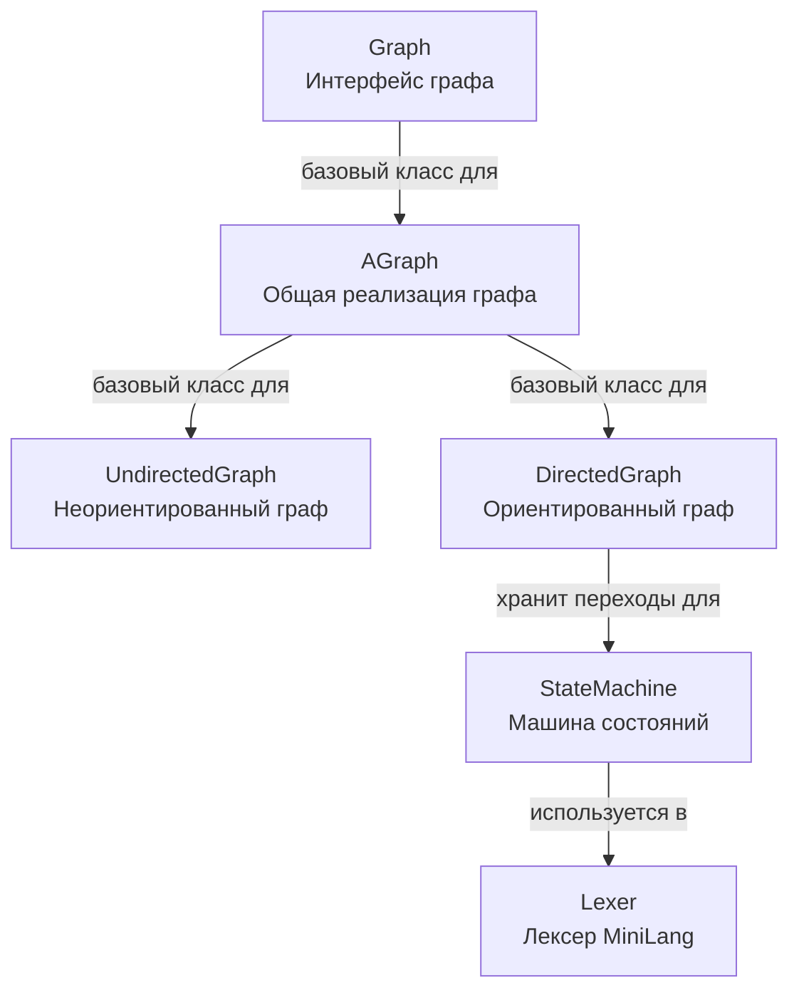
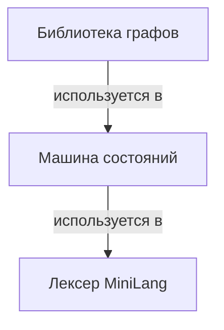

# Дизайн лабораторной работы № 3

## 1. Постановка задачи

Задача лабораторной работы — реализовать библиотеку для работы с ориентированными и неориентированными взвешенными графами. Библиотека должна позволять добавлять вершины и рёбра и получать списки смежности.

На основе библиотеки графов реализовать машину состояний. Она должна хранить переходы в ориентированном графе и менять текущее состояние в ответ на входные события.

На основе этой машины состояний реализовать лексер в интерпретаторе MiniLang. Лексер принимает исходный текст программы и возвращает последовательность токенов. При недопустимой лексеме он сообщает об ошибке.

## 2. Сущности и связи

| Класс | Назначение |
|---|---|
| `Graph` | Задаёт общий интерфейс работы с вершинами, рёбрами и списками смежности. |
| `AGraph` | Абстрактный базовый класс с общей реализацией хранения вершин и связей. |
| `UndirectedGraph` | Неориентированный граф. По ребру можно пройти в обе стороны. |
| `DirectedGraph` | Ориентированный граф. По дуге можно пройти от её начала к концу. |
| `StateMachine` | Детерминированная машина состояний. Хранит начальное и текущее состояния и выбирает переход по событию. Содержит ориентированный граф переходов. |
| `Lexer` | Лексер MiniLang. Создаёт машину состояний с правилами языка и использует её, чтобы определить границы и типы токенов. |

## 3. Архитектура

Каждая стрелка указывает, в каком компоненте используется предыдущий.

- **Библиотека графов → машина состояний.** Машина хранит переходы в орграфе и запрашивает у него дуги из текущего состояния. По спискам событий на этих дугах она определяет, какой переход выполнить.
- **Машина состояний → лексер.** Лексер задаёт правила переходов и подаёт машине события, соответствующие входным символам. По результатам переходов он определяет границы лексемы, а по текущему состоянию выбирает тип токена или обнаруживает ошибку.

### Графы

- `AGraph` хранит списки смежности в `Map<Vertex, Array<Edge>>`. Изолированной вершине соответствует пустой массив.
- При добавлении ребра граф регистрирует обе вершины. По ключу начальной вершины находится массив смежности, а поиск существующей записи в этом массиве выполняется линейно. При совпадении конечной вершины вес заменяется.
- `DirectedGraph` хранит одну запись в списке начала дуги. `UndirectedGraph` хранит по записи у обоих концов ребра, а для петли — одну. Отдельный счётчик увеличивается один раз на новое ребро и позволяет получить число рёбер без обхода списков.

### Машина состояний

- Переходы хранятся в `DirectedGraph<State, Array<Event>>`. Состояния служат вершинами, а в поле веса дуги лежит массив событий. Поэтому несколько событий из одного состояния в одно и то же состояние занимают одну дугу.
- При регистрации перехода машина проверяет исходящие дуги исходного состояния. Если событие уже записано на дуге к той же цели, регистрация завершается без изменений. Если событие записано на дуге к другой цели, машина выдаёт ошибку. Так у пары «состояние, событие» всегда не более одного назначения.
- Начальное и текущее состояния хранятся отдельно. При обработке события машина просматривает только дуги из текущего состояния и ищет событие в их массивах. Сброс присваивает текущему состоянию начальное и сохраняет граф переходов.

### Лексер MiniLang

- Лексер строит одну машину `StateMachine<LexerState, LexerEvent>` на вызов разбора. Каждый входной байт классифицируется как событие, например цифра, начало слова или кавычка. Поэтому один переход задаёт правило сразу для целой группы символов.
- Перед распознаванием очередной лексемы машина сбрасывается в `Start`. Лексер продвигается по тексту, пока для очередного события есть переход. Когда перехода нет, позиция остаётся на первом байте за распознанным фрагментом. При допустимом конечном состоянии этот байт будет обработан на следующей итерации.
- Тип токена определяется по состоянию, в котором остановилась машина. Для слова дополнительно проверяется полное совпадение с ключевым словом. Состояния после `=`, `<`, `>` и `!` позволяют присоединить следующий `=`. Состояния после открывающей кавычки и после `CR` позволяют отдельно обнаруживать незакрытую строку и одиночный `CR`.
- Лексема берётся из исходного текста по границам распознанного фрагмента. Токены с типом и лексемой накапливаются в собственном `Array<Token>`. После разбора добавляется `EndOfFile` с пустой лексемой.

## 4. Функциональные требования

### Общие требования

- Поддерживать сквозной лексический разбор. По исходному тексту система сама подготавливает правила MiniLang и граф переходов, затем применяет их до завершения разбора.
- Поддерживать самостоятельное использование библиотеки графов и машины состояний в других задачах. Вызывающий код может задавать собственные вершины, состояния и события.
- Обеспечивать независимость объектов и запусков. Каждый граф и каждая машина состояний имеют собственное состояние. Результат разбора одного и того же текста воспроизводится при повторном вызове, в том числе после разбора другого текста или лексической ошибки.

### Графы

| Действие | Ожидаемое поведение |
|---|---|
| Построить граф | Принять вершины и взвешенные рёбра для выбранного типа графа. Допускать изолированные вершины, несвязные компоненты и петли. При добавлении ребра зарегистрировать его концы, если их ещё нет. При повторном добавлении ребра использовать последний вес. |
| Получить данные о графе | Вернуть вершины, их число и число рёбер. Для заданной вершины вернуть доступные из неё переходы с весами. В ориентированном графе учитывать направление. Ребро неориентированного графа считать один раз, включая петлю. |
| Просмотреть граф | Показать вершины, веса рёбер и направления дуг. |

### Машина состояний

| Действие | Ожидаемое поведение |
|---|---|
| Создать машину | Установить заданное начальное состояние как текущее. |
| Зарегистрировать переход | Связать исходное состояние и событие с конечным состоянием. Допускать переход в то же состояние и несколько разных событий с одной целью. Повтор той же тройки не меняет машину. Другая цель для уже заданной пары «состояние, событие» вызывает ошибку, прежний переход сохраняется. |
| Обработать событие | При наличии перехода установить его конечное состояние и вернуть `true`. При отсутствии перехода вернуть `false` и сохранить текущее состояние. |
| Сбросить машину | Вернуть начальное состояние. Зарегистрированные переходы остаются доступны. |

### Лексер MiniLang

| Действие | Ожидаемое поведение |
|---|---|
| Распознать слова и числа | Распознавать целые числа из ASCII-цифр и идентификаторы из латинских букв, цифр и подчёркиваний. Первый символ идентификатора — буква или подчёркивание. Выдавать отдельный тип токена при полном совпадении с ключевым словом. |
| Распознать операторы и скобки | Выдавать токены для `+`, `-`, `*`, `/`, `=`, `<`, `>`, `(`, `)`. Последовательности `==`, `!=`, `<=` и `>=` выдавать как один токен каждая. |
| Распознать строку | Принять текст в двойных кавычках в пределах одной строки, включая пустую строку. Сохранить обе кавычки в лексеме. Обратная косая черта внутри строки читается как обычный символ. |
| Обработать пробелы и конец входа | Пропускать пробелы и табуляцию вне строк. Выдавать один токен перевода строки для LF или CRLF. Заканчивать последовательность токеном `EndOfFile`, в том числе для пустого входа. |
| Обработать лексическую ошибку | Сообщить о недопустимом символе, одиночном `!`, одиночном CR или строке без закрывающей кавычки до перевода строки либо конца входа. |
