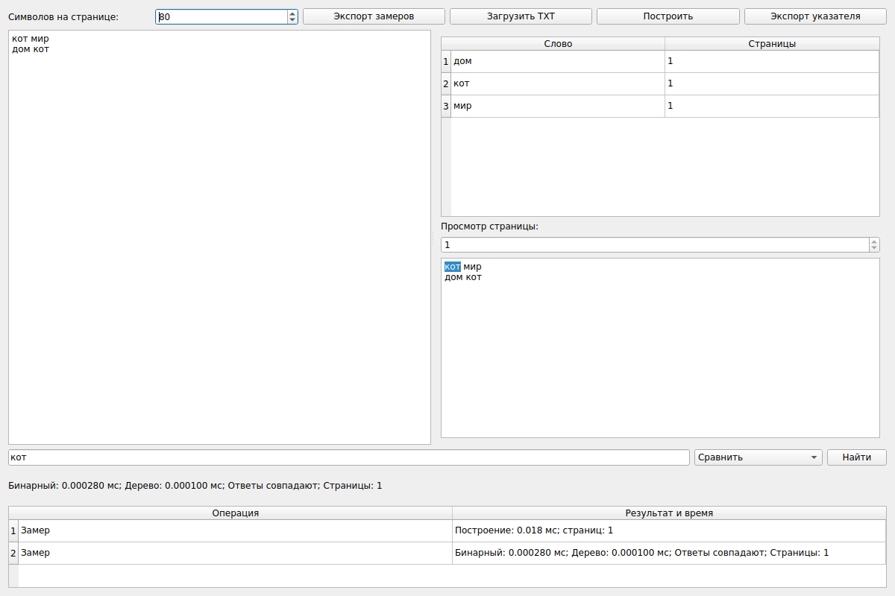
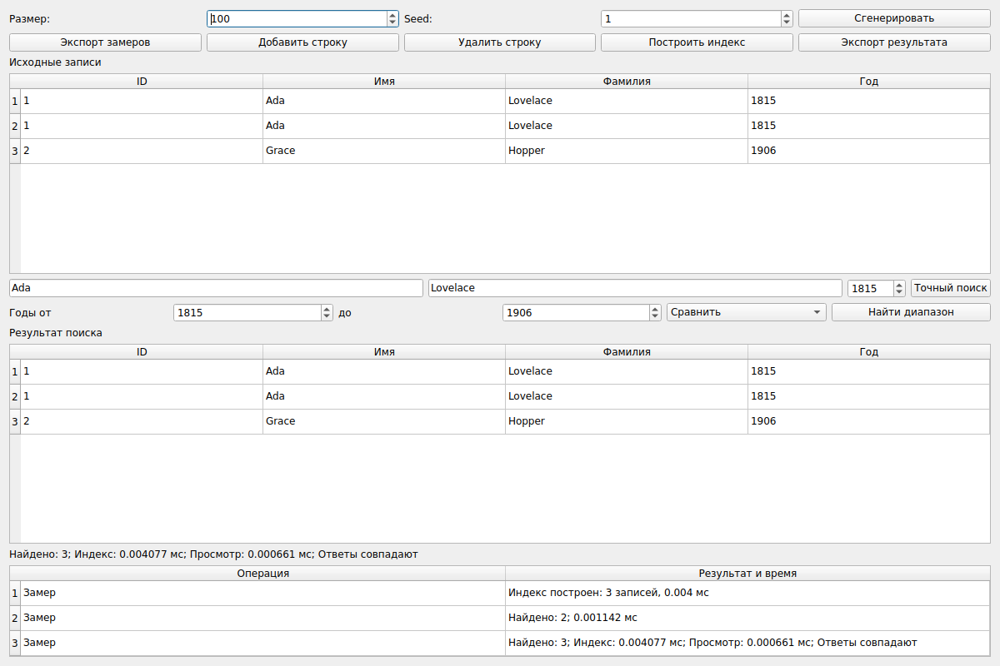
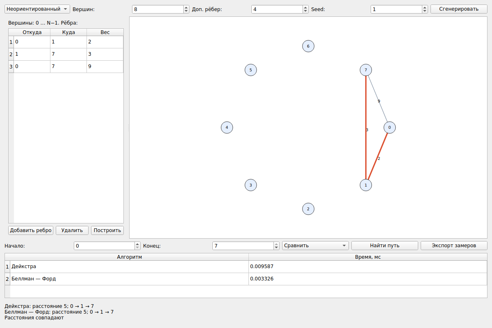

## Badges


[](LICENSE)

# DataStructures

Учебный проект на C++20 для изучения структур данных, алгоритмов поиска и устройства интерпретатора. В проекте есть собственные контейнеры и умные указатели, консольные лабораторные работы, графический интерфейс на Qt 6 и интерпретатор MiniLang.

## Documentation

| Дизайн | Содержание |
|---|---|
| [Умные указатели](SmartPointers/docs/specafication/Дизайн-Умных-Указателей.md) | Единоличное и совместное владение ресурсами. |
| [ЛР‑2. Индексация и поиск](SecondLab/docs/design.md) | Алфавитный указатель, индексы записей о людях и сравнение методов поиска. |
| [ЛР‑3. Кратчайшие пути](ThirdLab/docs/design.md) | Поиск кратчайшего пути в графе и сравнение алгоритмов. |
| [Интерпретатор MiniLang](Interpreter/docs/design.md) | Модель языка, компоненты интерпретатора и требования к выполнению программ. |

- [Задание ЛР‑2](SecondLab/docs/ЛР-2.pdf) и [задание ЛР‑3](ThirdLab/docs/ЛР-3.pdf)
- [Спецификация алфавитного указателя](DataStructures/docs/specs/alphabetical-index/specification.md) и [спецификация персонального индекса](DataStructures/docs/specs/person-index/specification.md)
- [Спецификация деревьев](DataStructures/docs/specs/trees/specification.md) и [спецификация умных указателей](DataStructures/docs/specs/pointers/specification.md)
- [Документация MiniLang](Interpreter/docs/README.md) с описанием языка, CLI и реализации

## Appendix

### Сборка и тестирование

Нужны компилятор C++20 и CMake 3.20 или новее. Для графического интерфейса нужны Qt 6 Widgets и Concurrent. В Ubuntu зависимости можно установить командой:

```bash
sudo apt install build-essential cmake qt6-base-dev libgtest-dev
```

Из корня проекта выполните:

```bash
cmake -S . -B /tmp/ds-build -DCMAKE_BUILD_TYPE=Release -DBUILD_GUI=ON
cmake --build /tmp/ds-build --parallel 2
ctest --test-dir /tmp/ds-build --output-on-failure
```

Для сборки без графического интерфейса задайте `-DBUILD_GUI=OFF`. Для сборки без тестов задайте `-DBUILD_TESTING=OFF`. При включённых тестах CMake использует установленный GoogleTest или загружает его автоматически. В сборке с GUI тесты интерфейса запускаются через Qt offscreen.

### Замеры

В лабораторных работах можно запустить сравнение алгоритмов на одних данных и сохранить замеры в CSV. GUI измеряет один запуск с учётом формирования ответа. Отрисовка выполняется после замера.

Результаты бенчмарков умных указателей доступны для [UniquePtr](DataStructures/docs/img/uniqueptr_benchmark.png) и [SharedPtr](DataStructures/docs/img/sharedptr_benchmark.png).

## Demo

После сборки запустите консольную программу и выберите ЛР‑2 или ЛР‑3. В обеих работах доступны ручной ввод и генерация данных для соответствующих задач.

```bash
/tmp/ds-build/DataStructures
```

Для запуска [графической демонстрации](#screenshots) выполните в графической сессии:

```bash
/tmp/ds-build/DataStructuresGui
```

В GUI можно построить указатель для текста из TXT, найти людей по диапазону годов рождения или сравнить алгоритмы поиска пути и увидеть найденный путь на графе.

[Пример MiniLang](Interpreter/examples/main.mini) вычисляет выражения, сохраняет значения в переменных и выводит `36.0`, `true` и `18.0` на отдельных строках.

```bash
/tmp/ds-build/MiniLangCpp Interpreter/examples/main.mini
```

## Screenshots

### Алфавитный указатель



### Персональный индекс



### Кратчайший путь



## Authors

- [@Krastti](https://github.com/Krastti)

## License

[MIT](LICENSE)
