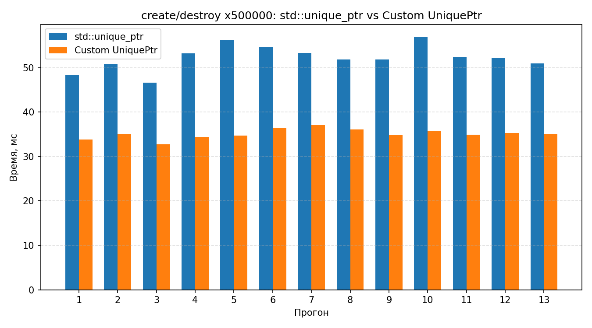
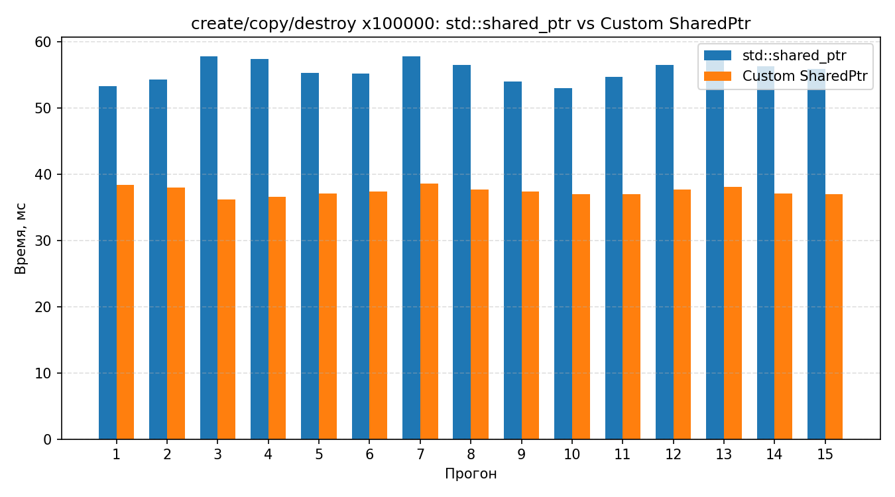

## Лабораторные работы

Проект содержит консольные реализации заданий ЛР-2 и ЛР-3 и графический интерфейс Qt 6.
Нужны CMake 3.20+ и компилятор C++20; для GUI дополнительно нужен Qt 6 Widgets/Concurrent.
В Ubuntu зависимости можно установить командой:

```bash
sudo apt install build-essential cmake qt6-base-dev libgtest-dev
```

Сборка и тестирование из корня проекта:

```bash
cmake -S . -B /tmp/ds-build -DCMAKE_BUILD_TYPE=Release -DBUILD_GUI=ON
cmake --build /tmp/ds-build --parallel 2
ctest --test-dir /tmp/ds-build --output-on-failure
```

Консольный запуск:

```bash
/tmp/ds-build/DataStructures
```

В меню выберите ЛР-2 или ЛР-3. Для проверки на произвольных данных доступны ручной и автоматический режимы; результаты замеров можно выгрузить в CSV.

### Бенчмарк для UniquePtr


### Бенчмарк для SharedPtr


## Графический интерфейс Qt 6

Консольная цель `DataStructures` сохранена. Для отдельного приложения
`DataStructuresGui` включите `-DBUILD_GUI=ON` (по умолчанию выключено).
После сборки запустите приложение в графической сессии:

```bash
/tmp/ds-build/DataStructuresGui
```

CSV сохраняется в выбранный пользователем файл. В CLion задайте
`-DBUILD_GUI=ON` в параметрах CMake и выберите цель `DataStructuresGui`.
Для сборки без интерфейса используйте `-DBUILD_GUI=OFF`.

- **Алфавитный указатель:** ввод или загрузка UTF-8 TXT, построение страниц,
  таблица слов, просмотр страницы, поиск двумя методами, сравнение и CSV.
  Щелчок по строке указателя открывает первую страницу слова и выделяет его.
- **Персональный индекс:** редактируемая таблица, генерация по seed,
  построение индекса, точный и диапазонный поиск, полный просмотр и сравнение.
  Изменение записей требует повторного построения индекса.
- **Графы:** ручная таблица рёбер или генерация, оба типа графов,
  поиск двумя алгоритмами, сравнение расстояний, подсветка пути.
  Вершины перемещаются мышью, колесо меняет масштаб.
  При более 200 вершинах или 1000 рёбрах остаётся табличное представление.
  Для отрицательных весов выбирайте Беллмана — Форда; ошибки алгоритмов
  (включая отрицательные циклы) показываются отдельным сообщением.

Построение и поиск выполняются в рабочем потоке. Замеры показывают один запуск
в миллисекундах, включая формирование ответа и без отрисовки; это ознакомительные
измерения, а не статистический бенчмарк. Для индексов и графов доступны CSV замеров.

Скриншоты: [алфавитный указатель](docs/img/gui-alphabetical.png),
[персональный индекс](docs/img/gui-people.png), [графы](docs/img/gui-graph.png).

При `BUILD_GUI=ON` CTest дополнительно запускает `GuiTests` через Qt offscreen:
проверяются поиск, сравнение ответов, сброс устаревших результатов, генерация графа,
ошибки ввода и рабочего потока, а также экранирование CSV. Подключение к реальному
дисплею проверяется отдельно при интерактивном запуске.

## Интерпретатор MiniLang

Отдельная цель `MiniLangCpp` выполняет файлы `.mini`. Точка входа — `interpreter/main.cpp`, заголовки и реализации компонентов находятся в `interpreter/headers/` и `interpreter/sources/`.

Сборка только интерпретатора без Qt и GoogleTest:

```bash
cmake -S . -B /tmp/ds-build -DCMAKE_BUILD_TYPE=Release -DBUILD_GUI=OFF -DBUILD_TESTING=OFF
cmake --build /tmp/ds-build --target MiniLangCpp --parallel 2
/tmp/ds-build/MiniLangCpp interpreter/examples/main.mini
```

Пример выводит `36.0`, `true` и `18.0` на отдельных строках. Для своей программы передайте путь к файлу; пути с пробелами заключайте в кавычки.

Чтобы собрать и запустить тесты без GUI, задайте `-DBUILD_GUI=OFF -DBUILD_TESTING=ON`, выполните полную сборку и `ctest --test-dir /tmp/ds-build --output-on-failure`. GoogleTest используется из системы или загружается CMake автоматически.

Результат программы выводится в `stdout`, ошибки — в `stderr`. Код завершения: `0` при успехе, `1` при ошибке обработки, `2` при неверном числе аргументов.

Подробнее: [сборка и запуск CLI](docs/interpreter/cli/README.md), [ТЗ](docs/interpreter/specification.md), [устройство исполнителя](docs/interpreter/execution/README.md).
