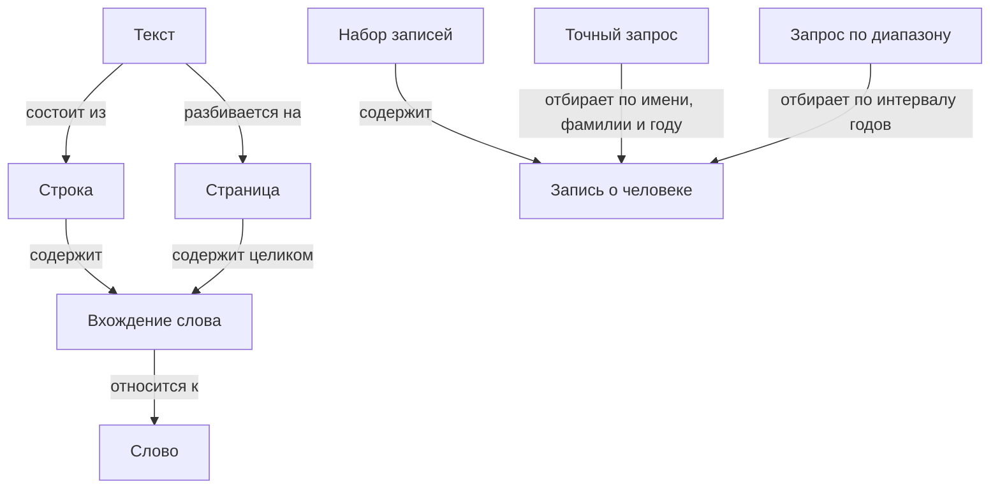
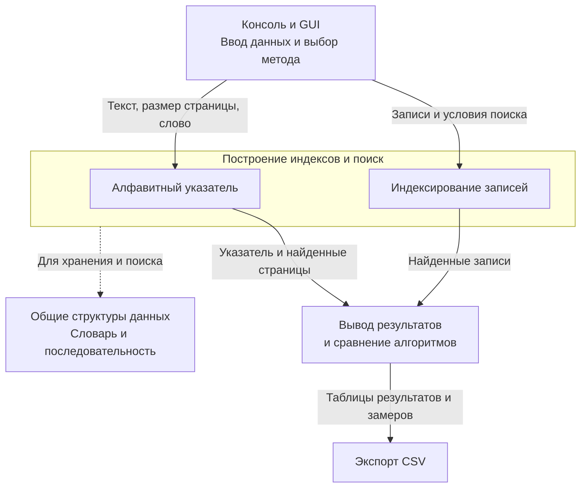

# Дизайн лабораторной работы № 2

## 1. Постановка задачи

Разработать программу для построения индексов и сравнения алгоритмов поиска на одинаковых данных.

- **Алфавитный указатель.** Разбить текст на страницы заданного размера в символах с учётом границ строк. Для каждого слова указать страницы, на которых оно встречается. Указатель позволяет найти нужное место в многостраничном тексте по слову.
- **Индексирование записей о людях.** Найти все записи с заданными именем, фамилией и годом рождения либо выбрать записи за заданный диапазон годов. Индексы подходят для повторных запросов к одному набору записей.

Для слова сравниваются бинарный поиск в упорядоченной последовательности и поиск в красно-чёрном дереве. Для диапазона годов сравниваются поиск по индексу и полный просмотр исходных записей.

Обе задачи доступны в консоли и в графическом интерфейсе (GUI). В графическом интерфейсе можно загрузить текст из файла, просмотреть страницы указателя и редактировать таблицу записей о людях.

## 2. Сущности и связи

| Сущность | Описание |
|---|---|
| Текст | Упорядоченная последовательность исходных строк. |
| Строка | Часть текста между переносами. Содержит ноль или более вхождений слов. |
| Вхождение слова | Позиция слова в исходном тексте. Одно и то же слово может встречаться несколько раз, в том числе на одной странице. |
| Слово | Последовательность непробельных символов. Регистр и пунктуация входят в написание слова. |
| Страница | Фрагмент текста с порядковым номером и ограничением по числу символов. Каждое вхождение слова целиком относится к одной странице. |
| Набор записей | Коллекция записей о людях, по которой выполняются запросы. |
| Запись о человеке | Идентификатор, имя, фамилия и год рождения. Несколько записей могут совпадать по имени, фамилии и году. |
| Точный запрос | Имя, фамилия и год рождения, которые должны совпасть с полями записи. |
| Запрос по диапазону | Нижняя и верхняя границы годов рождения. Обе границы входят в диапазон. |

## 3. Архитектура

### Ввод и просмотр данных

Консоль и графический интерфейс принимают исходные данные, параметры запроса и способ поиска. Исходные данные и ответы доступны для ручной проверки.

- **Консоль.** Ручной ввод текста и записей, генерация набора записей.
- **Графический интерфейс.** Ввод и загрузка текста из TXT, просмотр отдельных страниц, редактирование таблицы записей и генерация набора.

### Алфавитный указатель

1. **Разбиение текста.** Слова размещаются целиком и в исходном порядке. Между соседними словами на странице учитывается один знак: пробел внутри строки или перенос между непустыми строками.
2. **Построение указателя.** Красно-чёрное дерево хранит для каждого слова номера страниц без повторов. Обход дерева по возрастанию ключей даёт упорядоченную последовательность для вывода и бинарного поиска.
3. **Поиск слова.** Бинарный поиск делит последовательность пополам, а поиск в дереве выбирает ветвь по сравнению с ключом. Оба метода используют один порядок сравнения слов.

| Страница | Предельное заполнение |
|---|---:|
| Первая | ½ заданного размера |
| Каждая десятая | ¾ заданного размера |
| Остальные | Заданный размер |

Лимит округляется вниз и проверяется после каждого перехода. Если слово длиннее лимита пустой уменьшенной страницы, она остаётся пустой, а слово переносится дальше.

### Индексирование записей

| Запрос | Как выполняется |
|---|---|
| Точный | Словарь по ключу «имя, фамилия, год рождения» возвращает всю группу записей с этим ключом. |
| По диапазону через индекс | Словарь по году рождения пропускает ветви за границами диапазона и возвращает записи подходящих групп. |
| По диапазону полным просмотром | Проверка границ применяется к каждой исходной записи в порядке ввода. |

Оба словаря построены на красно-чёрных деревьях. Группировка сохраняет все записи с одинаковым ключом.

### Общие структуры данных

- **Упорядоченный словарь** поддерживает точный поиск, обход в порядке ключей и выборку диапазона.
- **Последовательность с доступом по позиции** хранит списки страниц, группы записей и упорядоченные записи указателя. Доступ по позиции нужен для бинарного поиска.

### Сравнение и экспорт

- **Сверка ответов.** Методы получают одинаковые данные и параметры запроса. Для слова сверяются списки страниц. Для диапазона сравниваются все поля записей с учётом повторов и независимо от порядка выдачи.
- **Замер поиска.** Время каждого метода включает формирование ответа. Вывод результата выполняется после замера.
- **Замер построения.** Консоль измеряет построение отдельно на трёх перестановках одного набора: по возрастанию, по убыванию и после перемешивания. Для записей порядок задаётся прежде всего годом рождения. Перестановки готовятся до замера.
- **Экспорт CSV.** Консоль сохраняет указатель, выборку по диапазону и замеры построения. В графическом интерфейсе можно выгрузить указатель, результаты поиска записей и замеры для проверки и построения графиков.

### Графический интерфейс

Алфавитный указатель и персональный индекс открываются в отдельных вкладках. В основной области показаны исходные данные и результаты. Справа расположены параметры построения индекса и поиска, внизу — статус последней операции и таблица замеров с экспортом в CSV. Размеры областей с данными можно менять разделителями.

В оформлении использованы тёмный фон, скруглённые элементы управления и бирюзовый акцент на кнопке построения индекса, как в GUI ЛР-1.

## 4. Функциональные требования

### Алфавитный указатель

| Действие | Ожидаемое поведение |
|---|---|
| Задать текст и размер страницы | Принять текст со строками и целый размер от двух символов. Длину слова считать в символах Unicode (кодовых точках). Повторные пробельные разделители сворачиваются, пустые строки пропускаются. |
| Построить указатель | Показать страницы в порядке номеров, начиная с 1. Сохранить порядок слов и границы между непустыми строками внутри страницы. Соблюсти лимиты первой, каждой десятой и обычных страниц. Вывести каждое различное слово один раз со списком номеров страниц по возрастанию, без повторов. |
| Найти слово | По выбранному методу вернуть все номера страниц с таким написанием слова. Для отсутствующего слова показать пустой результат. В режиме сравнения выполнить оба поиска и сообщить результаты сверки и замеров. |
| Просмотреть страницу | Показать содержимое выбранной страницы. В графическом интерфейсе выбор строки указателя открывает первую страницу вхождения слова. |
| Обработать особый ввод | Для пустого текста построить одну пустую страницу и пустой указатель. Если размер меньше двух символов или слово длиннее обычной страницы, сообщить об ошибке построения. |

### Индексирование записей

| Действие | Ожидаемое поведение |
|---|---|
| Подготовить набор записей | Принять записи с идентификатором, именем, фамилией и годом рождения либо сгенерировать их по заданным размеру и начальному значению генератора. Показать исходный набор. |
| Построить индексы | Сгруппировать записи по составному атрибуту и по году. Сохранить все записи, включая повторно добавленные. |
| Найти точные совпадения | Вернуть все записи, у которых совпали имя, фамилия и год. Сравнивать имя и фамилию с учётом регистра. Записи с одним ключом выдавать в порядке добавления. |
| Найти записи по диапазону | Принять две границы и вернуть все записи с годом внутри диапазона, включая обе границы. Равные границы задают один год. Индекс выдаёт записи по возрастанию года с сохранением порядка добавления внутри года. Полный просмотр выдаёт записи в порядке исходного набора. |
| Сравнить методы поиска по диапазону | Выполнить оба метода на одном наборе. Сопоставить состав результатов с учётом повторов и показать время каждого метода. |
| Обработать особый запрос | При нижней границе выше верхней сообщить об ошибке запроса, даже если набор пуст. Если границы допустимы, вернуть пустой результат при пустом наборе или отсутствии совпадений. |

### Общие сценарии

- При поиске через графический интерфейс требовать построения актуального указателя или индекса. После изменения текста, размера страницы или набора записей предложить построить его заново.
- Показывать исходные данные и результаты для ручной проверки. Если слово встречается на одной странице несколько раз, номер страницы выводится один раз. Если несколько записей имеют одинаковые имя, фамилию и год рождения, точный поиск возвращает их все в порядке добавления.
- Показывать время построения и поиска. Для трёх порядков входных данных сохранять в CSV порядок, объём входа и время построения.
