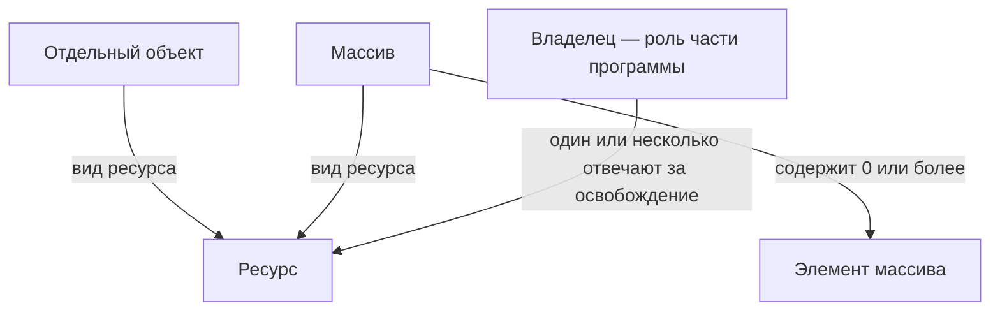
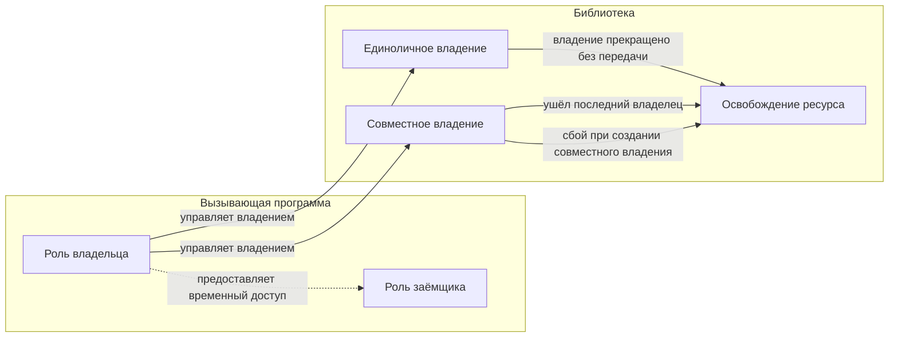

# Дизайн умных указателей

## 1. Постановка задачи

Разработать библиотеку, которая управляет временем жизни объектов и массивов, создаваемых во время работы программы. Библиотека автоматически освобождает ресурс, когда последний владелец прекращает владение без передачи ответственности. Для этого библиотека поддерживает единоличное и совместное владение.

Единоличное владение подходит, когда за ресурс отвечает одна часть программы, например когда узел дерева отвечает за свои дочерние узлы. Совместное владение подходит, когда один объект нужен нескольким частям программы. Заранее неизвестно, какая из них закончит работу последней.

## 2. Сущности и связи

| Сущность | Описание |
|---|---|
| Владелец | Роль части программы, которая отвечает за освобождение ресурса. За ресурс отвечает один владелец или несколько совместных владельцев. |
| Отдельный объект | Объект, созданный во время работы программы и имеющий самостоятельное время жизни. |
| Массив | Упорядоченная совокупность элементов одного типа. Массив создаётся и освобождается целиком. |
| Элемент массива | Значение на определённой позиции. Его время жизни ограничено временем жизни массива. |

Ресурсом далее называется отдельно созданный объект или массив, время жизни которого нужно контролировать.

## 3. Архитектура

**Вызывающая программа** создаёт ресурс и выбирает один из двух режимов. В роли владельца она передаёт ресурс библиотеке и управляет владением. В роли заёмщика она получает временный доступ через владельца.

**Единоличное владение** учитывает, за какой ресурс отвечает владелец. При передаче другому владельцу или возврате вызывающей программе ответственность переходит получателю. При завершении владения без передачи ответственности библиотека освобождает ресурс.

**Совместное владение** ведёт общий учёт числа владельцев каждого ресурса. Вступление в группу увеличивает это число, выход уменьшает, а передача доли заменяет одного участника другим. Переход от одного владельца к нулю служит сигналом к освобождению ресурса. Если создать совместное владение новым ресурсом не удалось, библиотека освобождает новый ресурс. Получатель продолжает владеть прежним.

**Освобождение ресурса** завершает время жизни отдельного объекта или массива со всеми его элементами. Компоненты владения указывают, какой ресурс нужно освободить и в какой момент.

## 4. Функциональные требования

### Общие операции

При начале владения и при замене новым ресурсом вызывающая программа передаёт ресурс, которым ещё никто не управляет. Владелец должен уметь освободить его целиком как отдельный объект или как массив.

| Действие | Ожидаемое поведение |
|---|---|
| Начать владение | Принять переданный ресурс. Владельца можно создать и без ресурса. |
| Проверить состояние | Определить, управляет ли владелец ресурсом. Владельцев одного вида можно сравнить. Их режим владения и требования к ресурсу должны совпадать. Они равны, если управляют одним ресурсом или оба пусты. |
| Получить временный доступ | Получить доступ к объекту или элементу массива без изменения владения. Доступ действителен, пока ресурс существует. При обращении к элементу вызывающая программа указывает индекс в пределах массива. |
| Обменяться ресурсами | Два владельца одного вида обмениваются ресурсами. Если один из них был пуст, другой становится пустым. Ресурсы остаются доступными, число владельцев каждого ресурса сохраняется. |
| Заменить ресурс | Принять новый ресурс и завершить прежнее владение. Если передан уже управляемый этим владельцем ресурс, состояние сохраняется. |
| Отказаться от владения | Оставить владельца пустым. Ресурс освобождается по общему правилу завершения владения. |
| Передать владение | Передать ресурс или долю совместимому владельцу того же режима. Получатель прекращает прежнее владение, а источник становится пустым. Передача от пустого источника оставляет получателя пустым. Передача самому себе сохраняет состояние. |

### Единоличное владение

- Поддерживать одного владельца на ресурс. Единоличное владение отдельным объектом можно передать владельцу другого вида только при совместимости с этим объектом и возможности корректно освободить его целиком. Для массива передача доступна между владельцами одного вида.
- Вернуть ответственность вызывающей программе. Владелец становится пустым, ресурс остаётся живым, а вызывающая программа отвечает за его дальнейшее освобождение или передачу новому владельцу.

### Совместное владение

- Передавать долю между владельцами одного вида.
- Разделить владение с новым или существующим владельцем того же вида. Источник сохраняет свою долю, получатель прекращает прежнее владение и присоединяется к группе источника. Если источник пуст, получатель остаётся без ресурса. Разделение владения с самим собой сохраняет состояние.
- Сообщить число владельцев управляемого ресурса. Для пустого владельца результат равен нулю. При одновременных операциях результат относится к моменту проверки.
- Если создать совместное владение переданным допустимым ресурсом не удалось, библиотека освобождает новый ресурс и сообщает вызывающей программе о сбое. При замене получатель продолжает владеть прежним ресурсом.

### Требования к библиотеке в целом

- Автоматически завершать владение по окончании времени жизни владельца, в том числе при досрочном выходе из операции, если при этом заканчивается время жизни владельца. Освобождать ресурс ровно один раз, если единоличный владелец прекратил владение без передачи ответственности или если ушёл последний совместный владелец.
- Поддерживать передачу единоличного владения и передачу или разделение совместного владения, когда источник находится внутри прежнего ресурса получателя. Получатель должен сохранить приобретённое владение после освобождения прежнего ресурса.
- Соблюдать правила совместного владения при одновременном создании и прекращении владения у разных участников одной группы. Вызывающая программа согласует одновременный доступ к самому ресурсу и изменение одного и того же владельца.
- При совместном владении по замкнутой цепочке ресурсы сохраняют друг друга. Чтобы освободить их, вызывающая программа разрывает цикл. После этого освобождение каждого ресурса по-прежнему зависит от ухода его последнего владельца.
