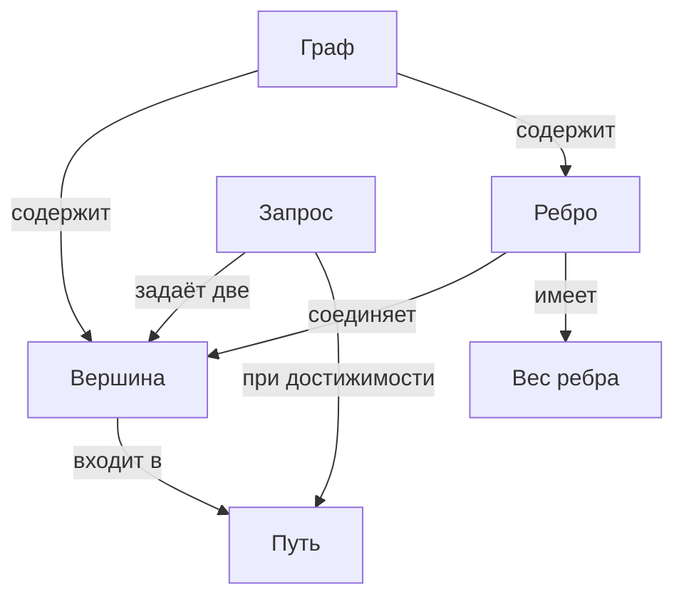
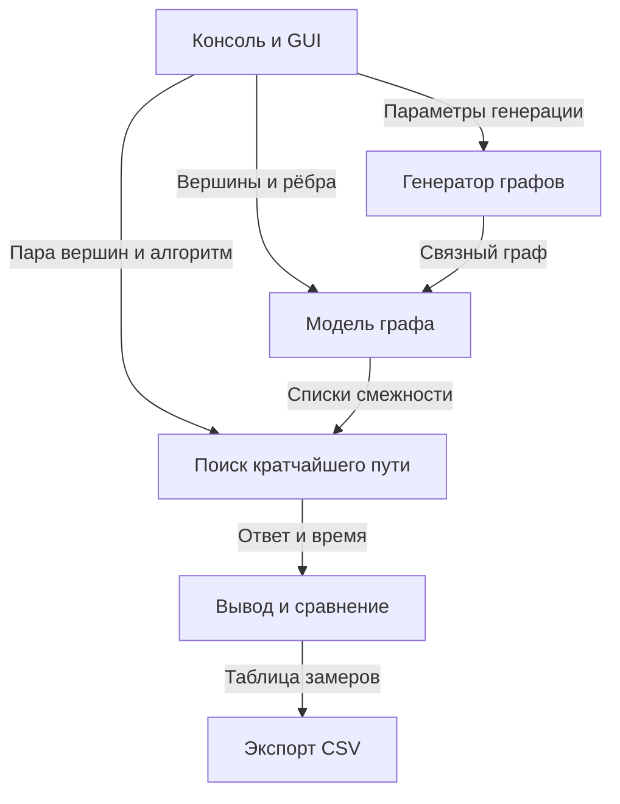
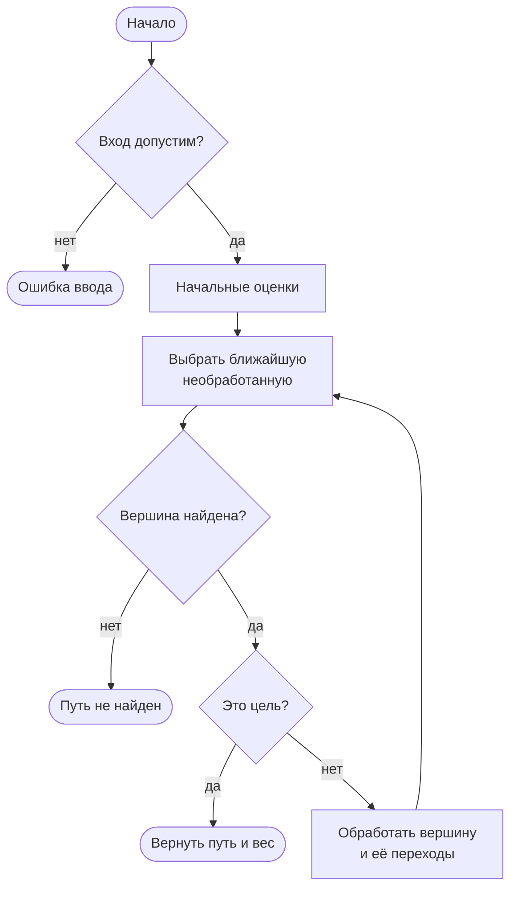
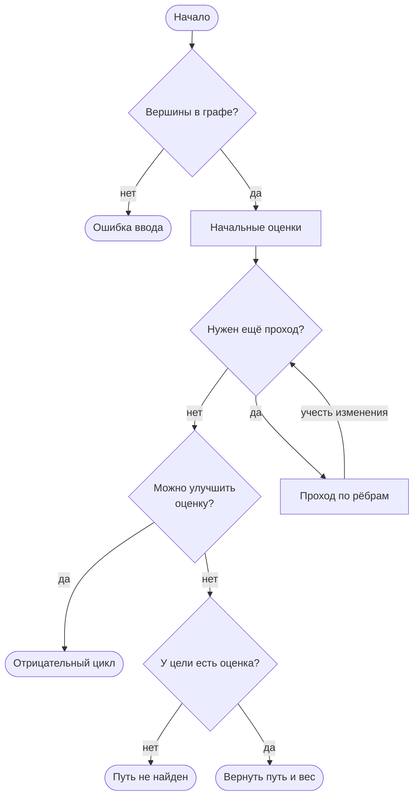

# Дизайн лабораторной работы № 3

## 1. Постановка задачи

Разработать программу для поиска кратчайшего пути во взвешенном графе и сравнения алгоритмов на одинаковых данных. Работа охватывает следующие пункты [задания ЛР‑3](ЛР-3.pdf).

- **Ориентированные и неориентированные графы (М‑1.1, М‑1.2).** Представить вершины и связи между ними. В ориентированном графе переход разрешён по направлению дуги, в неориентированном ребро можно пройти в обе стороны.
- **Поиск кратчайшего пути (М‑2.2.1).** Для двух заданных вершин найти путь с наименьшей суммой весов. Так можно выбрать маршрут с минимальной стоимостью проезда или передачи данных.
- **Генерация графов (М‑3.1).** По заданному числу вершин и дополнительных рёбер построить связный неориентированный или сильно связный ориентированный граф. Генерация позволяет сравнивать время поиска на графах разного размера и плотности.

Для поиска используются алгоритмы Дейкстры и Беллмана — Форда. Можно запустить один из них или сравнить оба на одном графе для одной пары вершин.

## 2. Сущности и связи

| Сущность | Описание |
|---|---|
| Граф | Набор вершин и взвешенных связей. Тип графа определяет допустимые направления переходов. |
| Вершина | Пункт с собственным идентификатором. Может быть изолированным. |
| Ребро | Связь между вершинами. В ориентированном графе называется дугой и имеет заданное направление. |
| Вес ребра | Стоимость одного перехода. Все веса выражены в одной единице измерения. Для поиска нужны нулевое значение, сложение и сравнение сумм. |
| Запрос | Начальная и конечная вершины одного графа. |
| Путь | Последовательность вершин от начальной до конечной. Соседние вершины соединены допустимым переходом. Вес пути равен сумме весов этих переходов. |

## 3. Архитектура

### Ввод и просмотр данных

Консоль и графический интерфейс принимают тип графа, данные для ручного построения или параметры генерации, пару вершин и способ поиска. Исходный граф и результат доступны для ручной проверки.

- **Консоль.** Ручной ввод или генерация графа, вывод списков смежности, найденного пути и времени поиска.
- **Графический интерфейс.** Ввод рёбер в таблицу или генерация графа, просмотр таблицы и схемы графа с подсветкой найденного пути. Для больших графов используется таблица рёбер.

### Построение графа

| Тип графа | Как задаются переходы | Как генератор обеспечивает связность |
|---|---|---|
| Неориентированный | Одно ребро даёт переходы в обе стороны и учитывается один раз. Для петли добавляется один переход. | Соединяет вершины цепочкой. |
| Ориентированный | Одна дуга даёт переход от начала к концу. Обратная дуга задаётся отдельно. | Соединяет вершины в направленный цикл. |

Для одной вершины рёбра для связности не нужны. После построения цепочки или цикла генератор выбирает заданное число свободных пар вершин без повторов и петель. Веса выбираются из неотрицательного диапазона. При одинаковых параметрах и начальном значении генератора получается один и тот же граф.

### Поиск кратчайшего пути

1. **Начальные оценки.** До начальной вершины расстояние равно нулю. Для остальных вершин оценка пока неизвестна.
2. **Релаксация перехода.** К оценке начала прибавляется вес ребра. Если у конца перехода ещё нет оценки или сумма меньше текущей, сохраняются новая оценка и предшественник.
3. **Восстановление ответа.** От конечной вершины проходят по предшественникам до начальной и разворачивают полученную последовательность. Если у цели нет оценки, путь отсутствует.

| Алгоритм | Как выполняется поиск |
|---|---|
| Дейкстры | Допускает только неотрицательные веса. Просматривает необработанные вершины и выбирает ближайшую с известной оценкой. После выбора цели возвращает путь. Если выбрать больше некого, цель недостижима. |
| Беллмана — Форда | Допускает отрицательные веса. Выполняет не более N − 1 проходов, где N — число вершин. За проход рассматривает переходы из всех вершин с известной оценкой. Если ни одна оценка не улучшилась, прекращает проходы. Затем проверяет, можно ли ещё улучшить оценку. В этом случае сообщает об отрицательном цикле, достижимом из начальной вершины, даже если из цикла нельзя попасть в конечную. |

#### Алгоритм Дейкстры

#### Алгоритм Беллмана — Форда

### Общие структуры данных

- **Словарь** связывает вершины со списками смежности, а во время поиска — с оценками расстояний и предшественниками.
- **Последовательность** хранит исходящие переходы и вершины найденного пути. Списки смежности позволяют перебирать переходы одной вершины. При повторном задании ребра в списке обновляется вес существующего перехода.

Словари и последовательности предоставляются библиотекой структур данных предыдущих работ.

### Сравнение и экспорт

- **Сверка ответов.** Оба метода получают один граф и одну пару вершин. Сверяются достижимость цели и минимальный вес. При нескольких кратчайших путях последовательности вершин могут различаться.
- **Замер поиска.** Время включает проверки входных данных и формирование ответа. Граф готовится до замера, вывод и экспорт выполняются после него.
- **Экспорт CSV.** Замеры сохраняются для построения графиков. Для сравнения серий опытов используются алгоритм, тип графа, числа вершин и рёбер, пара вершин, результат и время с указанной единицей измерения.

## 4. Функциональные требования

### Построение графа

| Действие | Ожидаемое поведение |
|---|---|
| Задать граф вручную | Принять тип графа, вершины и рёбра с весами. Допускать изолированные вершины, несвязные компоненты и петли. При повторном задании ребра использовать последний вес. |
| Сгенерировать граф | Принять тип, число вершин, число дополнительных рёбер и начальное значение генератора. Построить связный неориентированный или сильно связный ориентированный граф с неотрицательными весами. |
| Обработать ошибку генерации | Сообщить об ошибке, если число вершин меньше 1 или превышает предел генератора, диапазон весов недопустим либо дополнительных рёбер больше, чем свободных пар вершин. |
| Просмотреть граф | Показать вершины и рёбра с весами. Для каждой дуги указать направление. |

### Поиск и сравнение

| Действие | Ожидаемое поведение |
|---|---|
| Найти кратчайший путь | Запустить выбранный алгоритм и показать последовательность вершин и минимальный вес. При нескольких равных по весу кратчайших путях вернуть один из них. |
| Обработать особый запрос | Для недостижимой цели сообщить «путь не найден». Если начальная и конечная вершины совпадают и запрос допустим, вернуть одну вершину с весом 0. |
| Обработать ошибку поиска | Сообщить об отсутствующей вершине запроса. При запуске Дейкстры сообщить об отрицательном ребре. При запуске Беллмана — Форда сообщить о достижимом из начала отрицательном цикле. |
| Сравнить алгоритмы | На одном графе с неотрицательными весами выполнить оба поиска, показать время каждого метода и сообщить итог сверки. |
| Выгрузить замеры | Сохранить таблицу CSV с названием алгоритма и временем в указанной единице измерения. |

### Общие сценарии

- Показывать исходный граф и результат для ручной проверки. Например, при дугах A → B весом 2, B → C весом 3 и A → C весом 9 оба метода должны найти путь A → B → C весом 5. Запрос из C в A должен сообщить о недостижимости.
- Для автоматической проверки покрыть тестами направления переходов, совпадающие и отсутствующие вершины запроса, равные по весу пути, отрицательное ребро, достижимый и недостижимый отрицательные циклы.
- Для генератора проверить число вершин и рёбер, связность, диапазон весов и повторяемость при одинаковых параметрах.
