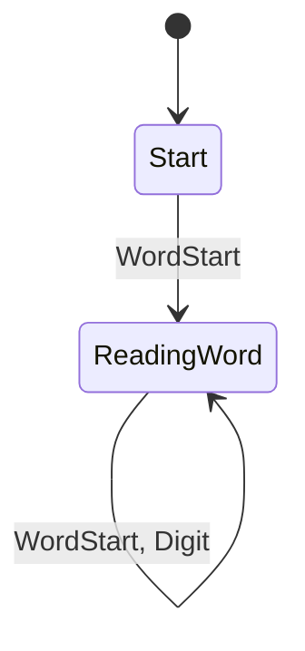
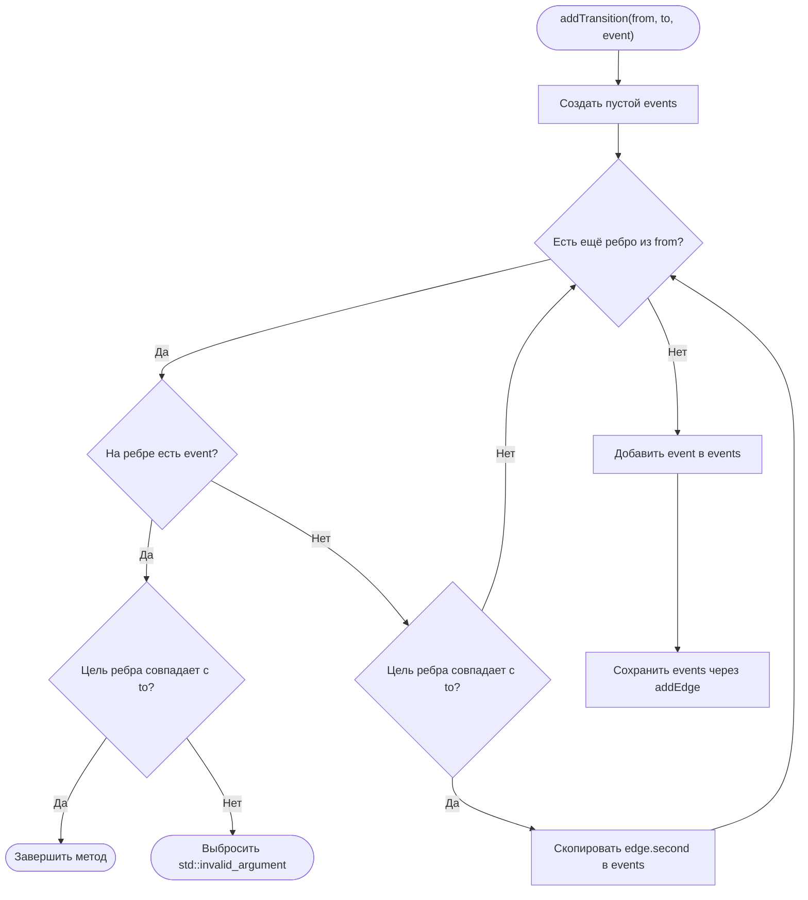
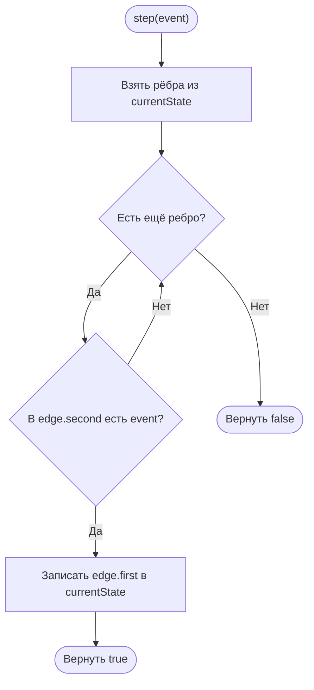

# Теория ЛР-3. Машина состояний на ориентированном графе

Автомат запоминает, в каком состоянии он находится. Получив событие, он ищет стрелку из текущего состояния, по которой можно пройти. Например, лексер в состоянии «читаю слово» получает цифру и остаётся в том же состоянии. Поэтому `print2` читается целиком.

Метод `addTransition()` добавляет правило в граф. Метод `step()` применяет правило к текущему состоянию. [Реализация StateMachine](../headers/StateMachine/StateMachine.tpp)

## Как граф хранит правила

`StateMachine` хранит переходы в поле `transitions` типа `DirectedGraph<State, Array<Event>>`. Вершина — состояние. Стрелка от одной вершины к другой — переход. На стрелке записаны события, которые его разрешают.

Например, из `Start` по событию `WordStart` лексер начинает читать слово. Пока приходят буквы или цифры, он идёт по петле и остаётся в `ReadingWord`.

Граф хранит **одно ребро на каждую упорядоченную пару состояний**. Поэтому в петле `ReadingWord → ReadingWord` лежит один массив с двумя событиями. В коде `edge.first` содержит конечное состояние, а `edge.second` — этот массив. [Реализация DirectedGraph](../../DataStructures/Graph/AGraph.tpp)

## Как работает addTransition

Вызов `addTransition(from, to, event)` задаёт правило «из `from` по событию `event` перейти в `to`».

1. Метод создаёт пустой временный массив `events` и перебирает рёбра, выходящие из `from`. Если вершины `from` ещё нет, обход пропускается.
2. Для каждого ребра `sameDestination` показывает, совпадает ли его цель `edge.first` с аргументом `to`.
3. Если `containsEvent(edge.second, event)` нашёл событие, результат зависит от цели. При той же цели правило уже есть и метод заканчивается. При другой цели возникает конфликт, и метод выбрасывает `std::invalid_argument`.
4. Если событие на ребре отсутствует, а цель совпадает, метод копирует `edge.second` в локальный `events`. Обход продолжается, потому что то же событие может встретиться у другого ребра.
5. После обхода метод добавляет новое событие в `events` и передаёт весь массив в `addEdge()`. Граф создаёт ребро или заменяет массив на существующем ребре.

### Пример с петлёй

Пусть сначала добавили правило `addTransition(ReadingWord, ReadingWord, WordStart)`. Граф создал петлю и сохранил в ней `[WordStart]`.

Теперь вызываем `addTransition(ReadingWord, ReadingWord, Digit)`. Метод находит петлю, видит ту же цель и копирует `[WordStart]` во временный массив. После проверки остальных рёбер он дописывает `Digit` и сохраняет `[WordStart, Digit]`. Временный массив исчезает после выхода из метода, а обновлённый массив остаётся внутри ребра в графе.

| Следующий вызов | Что произойдёт |
|---|---|
| `addTransition(ReadingWord, ReadingWord, Digit)` | Правило уже есть. Метод сразу завершится. |
| `addTransition(ReadingWord, ReadingNumber, Digit)` | Для `Digit` уже задана другая цель. Метод выбросит исключение до изменения графа. |

Так автомат остаётся детерминированным. Из одного состояния по одному событию можно попасть максимум в одно состояние. В другом исходном состоянии то же событие может вести в другую вершину.

## Как работает step

Вызов `step(event)` берёт исходящие рёбра из `currentState` и по очереди ищет в них событие. Вспомогательный метод `containsEvent()` сравнивает `event` с элементами массива `edge.second`. При первом совпадении `step()` записывает цель ребра в `currentState` и возвращает `true`. Если все рёбра проверены и совпадений нет, метод возвращает `false`, сохраняя текущее состояние.

Для графа на первой диаграмме получатся такие шаги.

| Состояние до вызова | Вызов | Результат | Состояние после вызова |
|---|---|---|---|
| `Start` | `step(WordStart)` | `true` | `ReadingWord` |
| `ReadingWord` | `step(Digit)` | `true` | `ReadingWord` |
| `ReadingWord` | `step(Space)` | `false` | `ReadingWord` |

На втором шаге сработала петля. Значение состояния осталось прежним, но автомат нашёл переход, поэтому вернул `true`. На третьем шаге переход по пробелу отсутствует в этом примере. Что делать с результатом `false`, решает вызывающий код.

[Тесты StateMachine](../tests/StateMachineTests.cpp)
