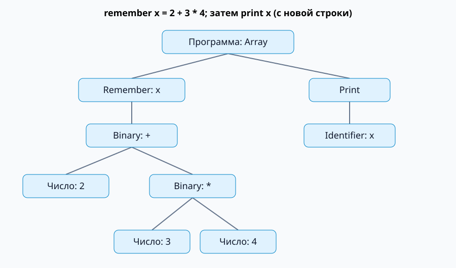
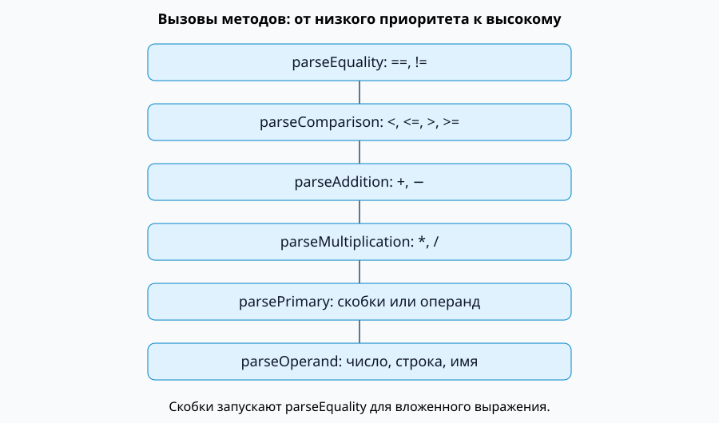

# Парсер MiniLang: от токенов к AST

Парсер получает `Array<Token>` от лексера, проверяет синтаксис и возвращает `Array<UniquePtr<ast::Statement>>`. Он не вычисляет выражения и не обращается к таблице переменных. Требования к языку находятся в [ТЗ](../specification.md), порядок развития — в [плане](../implementation-plan.md).

## Файлы модуля

```text
interpreter/
├── main.cpp           — точка входа CLI
├── examples/          — примеры .mini
├── headers/
│   ├── token.h         — токены
│   ├── lexer.h         — интерфейс лексера
│   ├── parser.h        — интерфейс и методы разбора
│   ├── expressions.h   — узлы выражений
│   ├── expressionTree.h — владение деревом выражения
│   ├── statements.h    — узлы инструкций
│   ├── visitors.h      — интерфейсы посетителей
│   └── interpreter.h   — интерфейс исполнителя
└── sources/
    ├── lexer.cpp
    ├── parser.cpp
    ├── ast.cpp         — конструкторы узлов и accept
    ├── expressionTree.cpp — сборка дерева выражения
    └── interpreter.cpp — выполнение AST
```

Вместо `Parser::Binary` используется `ast::Binary`, вместо `Parser::Statement` — `ast::Statement`. Для работы с узлами подключайте `expressions.h` или `statements.h`, для реализации посетителя — также `visitors.h`. В `parser.h` остаются только объявления, связанные с разбором токенов.

## Что такое AST

Абстрактное синтаксическое дерево (AST) хранит смысловую структуру программы. Листья представляют числа, строки и имена, внутренние узлы — операции и инструкции. Скобки определяют форму дерева, но отдельный узел для них не нужен. Переводы строк и EOF также не становятся узлами.

Например, `remember x = 2 + 3 * 4` и `print x` превращаются в следующую структуру:



Умножение расположено внутри правой ветви сложения, поэтому исполнитель сначала получит результат `3 * 4`. Дерево не балансируется: перестановка узлов изменила бы смысл программы. Красно-чёрное дерево проекта предназначено для таблицы переменных, а не для синтаксических связей.

## Грамматика

Упрощённая EBNF реализованного синтаксиса:

```text
program        = { NEWLINE | statement (NEWLINE | конец_перед_EOF) } EOF ;
statement      = "remember" IDENTIFIER "=" equality | "print" equality ;
equality       = comparison { ("==" | "!=") comparison } ;
comparison     = addition { ("<" | "<=" | ">" | ">=") addition } ;
addition       = multiplication { ("+" | "-") multiplication } ;
multiplication = primary { ("*" | "/") primary } ;
primary        = NUMBER | STRING | IDENTIFIER | "(" equality ")" ;
```

`конец_перед_EOF` обозначает завершение последней инструкции без перевода строки и не является отдельным токеном. После инструкции допускаются только перевод строки или EOF; две инструкции на одной строке запрещены. Пустые строки допустимы.

## Рекурсивный спуск и приоритеты

Каждому уровню грамматики соответствует метод. Разбор начинается с `parseEquality`; каждый уровень получает операнды у следующего, более приоритетного уровня.



`parseOperand` создаёт лист. `parsePrimary` обрабатывает скобки, вызывая внутри них `parseEquality`, либо передаёт работу `parseOperand`.

Методы бинарных уровней сначала разбирают левый операнд. Затем, пока встречается оператор их уровня, разбирают правый операнд и создают новый `Binary`, помещая предыдущее дерево слева. Это обеспечивает левую ассоциативность: `10 - 3 - 2` представляется как `(10 - 3) - 2`, а не `10 - (3 - 2)`.

`ParsedExpr` содержит дерево `ExpressionTree` и `nextPosition` — индекс первого ещё не обработанного токена. Например, при разборе выражения в скобках этот индекс указывает на закрывающую скобку, которую проверяет и пропускает `parsePrimary`.

## Узлы и конструкторы

Узлы AST находятся в пространстве имён `ast` и не зависят от класса `Parser`:

| Тип | Содержание |
|---|---|
| `NumberLiteral` | Исходная запись числа в `lexeme` |
| `StringLiteral` | Исходная запись строки в `lexeme`, включая кавычки |
| `Identifier` | Имя переменной |
| `Binary` | Оператор и два дочерних выражения |
| `Remember` | Имя переменной и выражение справа от `=` |
| `Print` | Выражение для вывода |

Базовые `Expr` и `Statement` имеют виртуальные деструкторы. Конструкторы инструкций принимают `ExpressionTree` перемещением. Кавычки из строковой лексемы снимает исполнитель. Экранирование пока не поддерживается.

## Посетитель для AST

В `interpreter/headers/visitors.h` объявлены два интерфейса в пространстве имён `ast`: `ExprVisitor` для выражений и `StatementVisitor` для инструкций. Для каждого конкретного узла предусмотрена своя перегрузка `visit(const Node&)`.

Базовые `Expr` и `Statement` объявляют чисто виртуальный `accept`, а конкретный узел вызывает в нём `visitor.visit(*this)`. Даже при обращении через базовый тип обработчик выбирается по фактическому типу узла:

```text
const Expr& → Binary::accept → ExprVisitor::visit(const Binary&)
```

`accept` доступен для константных узлов и не передаёт владение AST. Дочерние узлы он автоматически не обходит: посетитель сам решает, когда вызвать их `accept` и в каком порядке.

Оба интерфейса возвращают `void`. При необходимости посетитель хранит результат обработки в своих полях; `Interpreter` использует для этого `Optional<Value>` (см. [описание выполнения](../execution/README.md)). Конкретный посетитель должен реализовать все перегрузки своего интерфейса. Исполнитель реализует оба интерфейса посетителей.

## Владение памятью и собственные структуры

Массив владеет инструкциями через `UniquePtr<Statement>`. Каждая инструкция хранит `ExpressionTree`, которое владеет всеми узлами своего выражения.

```text
Array<UniquePtr<Statement>> → инструкция → ExpressionTree → корень Expr
                                             │
                                             └── владеет всеми узлами выражения
```

`makeBinary` сначала выделяет узел операции, затем передаёт ему корни двух поддеревьев. Исходные деревья становятся пустыми, адреса узлов сохраняются. `leftOperand()` и `rightOperand()` возвращают указатели для чтения. Узлы выражений хранят собственные строки, поэтому массив токенов можно уничтожить после разбора.

`ExpressionTree` и дерево поиска `BinaryTree` используют `BinaryTreeBase`. Основа хранит корень и число узлов, передаёт владение при перемещении и удаляет узлы по связям с родителем без рекурсии и дополнительных выделений памяти. Правила вставки по ключу и балансировки принадлежат деревьям поиска.

Для хранения некопируемых владельцев доработан `Array::push_back`: копируемые элементы обрабатываются как прежде, а некопируемые — через перемещение. При расширении некопируемый элемент должен поддерживать присваивание перемещением без исключений. `UniquePtr` удовлетворяет этому требованию. Алгоритм расширения и порог заполнения массива сохранены.

При ошибке локальные владельцы и уже построенная часть программы уничтожаются автоматически. Парсер не хранит состояние между вызовами, поэтому после ошибки его можно использовать повторно.

## Проверка синтаксиса и ошибки

`requireToken` проверяет границу массива и ожидаемый тип, затем возвращает токен по константной ссылке. На ошибках выбрасывается `std::invalid_argument` с описанием причины; координаты будут добавлены позднее.

Вход должен содержать ровно один EOF в конце. Парсер отвергает отсутствие EOF, преждевременный EOF, пропущенное имя или `=`, пустые и незакрытые скобки, отсутствующие операнды и лишние токены после инструкции.

Проверка типов относится к исполнителю. Поэтому парсер может построить дерево для `print "a" + 1` или `print 1 < 2 < 3`: их допустимость при выполнении определяется семантикой операций исполнителя. Унарный минус, функции, условия и циклы пока не разбираются.

## Проверки

[Тесты парсера](../../../tests/Interpreter/ParserTests.cpp) проверяют структуру AST, приоритеты, левую ассоциативность, строки, порядок инструкций, рост и перемещение массива программы, ошибочные входы и повторное использование парсера. Проверки посетителей охватывают все типы узлов, вызов через константный базовый тип и порядок обхода дерева. [Тесты Array](../../../tests/Array/ArrayTests.cpp) дополнены проверкой некопируемых владельцев и однократного освобождения ресурсов.

`sources/parser.cpp` и `sources/ast.cpp` входят в `MiniLangCore`, связанную с CLI и `UnitTests`. Тесты парсера включены в `UnitTests`. Для штатного запуска используются команды сборки и CTest из корневого `AGENTS.md`.
