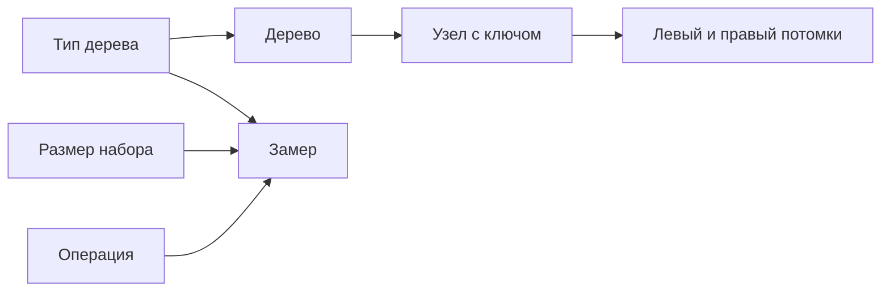
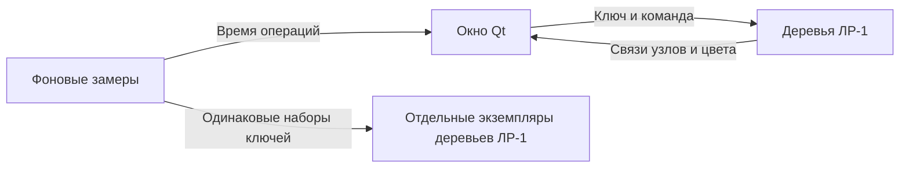

# Графический интерфейс деревьев ЛР-1

## Постановка задачи

Приложение показывает строение двоичного дерева поиска и красно-чёрного дерева. Пользователь видит, как вставка и удаление меняют форму дерева, и сравнивает время одинаковых операций на обеих структурах.

## Сущности и связи

Дерево состоит из узлов с целочисленными ключами. У каждого узла до двух потомков. Узлы красно-чёрного дерева имеют цвет. Замер относится к типу дерева, размеру набора и операции.

## Архитектура

Окно Qt показывает фактические связи узлов и направляет команды выбранному дереву проекта. Для предпросмотра приложение открывает оба дерева с одним набором ключей. Замеры выполняются в фоновом потоке на отдельных деревьях. Для каждой пары сравниваемых деревьев используются одинаковые входные данные.

## Функциональные требования

- Вкладки переключают деревья с независимым состоянием.
- Вставка и удаление обновляют рисунок. Повторная вставка и удаление отсутствующего ключа сопровождаются сообщением.
- Поиск подсвечивает найденный узел или сообщает, что ключ отсутствует.
- Генерация заменяет выбранное дерево набором случайных ключей.
- График показывает суммарное время пакета операций для 1 000, 10 000, 100 000 и 500 000 узлов. В таблице можно выбрать любой из этих размеров и посмотреть среднее время вставки, поиска и удаления для обоих деревьев.
- Приложение запускается из отдельной конфигурации CLion.
